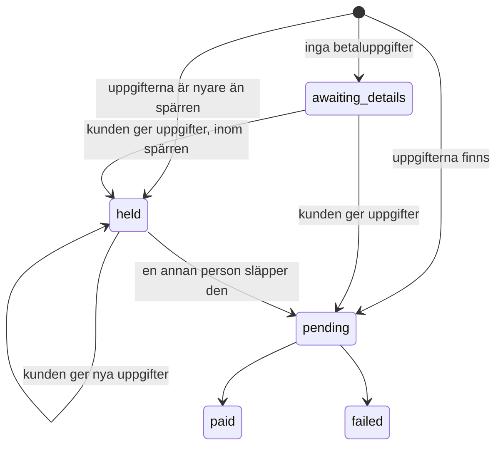

# Premier och betalningar

Hur Petvold delar en terms premie i delbetalningar, fördelar en betalning och räknar ut vad ett avslut betyder i pengar (ADR 0040).

**Läge:** räkningen finns i `billing-core` (steg 1 av 8). Modulen `billing` gör premieplaner, fakturor och kreditnotor (steg 2). Modulen `payments` tar emot inbetalningar (steg 3a), och `billing` kopplar dem till fakturorna (steg 3b). `payments` betalar ut skadornas ersättning till försäkringstagaren, eller till kliniken vid direktreglering (steg 3c). Körningen `billing.dunning` påminner om obetalda fakturor och säger upp för obetald premie (steg 4). Körningen `billing.credits` använder tillgodohavanden på fakturorna eller betalar tillbaka dem (steg 5a).

## Betalarkonto och premieplan

När en policy tecknas (`policy.issued`) eller förnyas (`policy.renewed`) gör `billing` en premieplan för termen:

- **Betalarkontot** är försäkringstagarens, ett per marknad och valuta. Det skapas med den första planen, och senare policyer hamnar på samma konto. Betalsättet är faktura tills betalningsmodulen finns.
- **Intervallet** är det kunden valde vid tecknandet (`paymentInterval`, se [Policyer](policyer.md#teckna-en-policy)), annars produktens förval (`billing.defaultPaymentInterval`, se [Produktkonfiguration](produktkonfiguration.md#produkter-och-produktversioner)). Vid förnyelse behålls förra termens intervall om produkten fortfarande tillåter det, och annars gäller förvalet.
- **Den första premien** räknas från den dag policyn tecknades, eftersom försäkringsbrevet och avin går ut samtidigt. I Sverige förfaller den fjorton dagar senare, men aldrig före termens början.
- **Skatten** kommer från marknadens regler (`BILLING_MARKET_RULES`). Sverige har ingen skatt på premien. En marknad utan regler ger ett fel som reläet försöker igen, så att ingen plan görs med fel regler.
- Samma händelse två gånger ger bara en plan.

| Anrop | Vad det ger |
| --- | --- |
| `GET /v1/payer-accounts?partyId=…&market=…` | Betalarkonton |
| `GET /v1/payer-accounts/{accountId}` | Ett betalarkonto |
| `GET /v1/premium-plans?policyId=…` eller `?accountId=…` | Premieplanerna med underlaget (`input`) och resultatet (`plan`), äldst först |

Alla tre kräver `billing:read` (rollen `billing-clerk`). Kundportalen (`customer-channel`) ser premieplanerna för sina egna policyer.

## Fakturor

**Faktureringen** är körningen `billing.invoicing` ([Körningar](korningar.md)), som går klockan 04:00 varje dag i varje marknad, efter förnyelsen. Den tar varje delbetalning som inte fakturerats och som förfaller inom planens framförhållning (`billing.invoiceLeadDays`, förval 31 dagar). Allt för samma betalarkonto hamnar på **en faktura**, också när kunden har flera policyer med olika intervall.

- **Fakturans förfallodag** är den tidigaste radens, men aldrig tidigare än lagen tillåter för någon rad (FAL 5 kap. 1 §):
  - **Den första premien** för en ny policy förfaller tidigast fjorton dagar efter fakturan.
  - **En senare premie**, också vid förnyelse, förfaller tidigast en månad efter fakturan.
- **Förvalet 31 dagar** gör att en senare premie normalt förfaller på periodens första dag, eftersom en månad aldrig är längre än 31 dagar. En kortare framförhållning, eller en körning som inte gått på några dagar, flyttar förfallodagen framåt. Den flyttas aldrig bakåt.
- **En delbetalning faktureras bara en gång.** Två körningar samtidigt kan inte fakturera samma delbetalning.
- **En faktura ändras aldrig.** En rättelse blir en kreditnota (steg 5).
- **En provkörning** (`dryRun`) visar vilka fakturor som skulle göras utan att spara något.

**Fakturanumret** tas ur en obruten serie per marknad och år, till exempel `SE-2026-000001` (bokföringslagen 5 kap. 7 §). Numret tas i samma transaktion som fakturan sparas, så en faktura som inte sparas tar inget nummer.

**Betalningsreferensen** gör att en inbetalning kan kopplas till fakturan utan manuellt arbete:

| Marknad | Referens | Exempel för faktura 1 år 2026 |
| --- | --- | --- |
| Sverige | OCR för Bankgirot: fakturans år och nummer, en längdsiffra (referensens längd modulo 10) och en kontrollsiffra enligt Luhn (modulo 10). Banken kan då vägra en referens med en siffra för mycket eller för lite. | `202600000121` |
| EUR-marknader | RF-referens enligt ISO 11649: `RF`, två kontrollsiffror (modulo 97) och fakturans år och nummer | `RF422026000001` |

**Exempel:** Anna tecknar en hundförsäkring den 22 november 2026 som börjar den 25 november och betalas per månad med 400 kr. Faktureringen samma dag gör faktura `SE-2026-000001` på 400 kr. Den förfaller den 6 december, fjorton dagar efter fakturan. Faktureringen den 24 november tar hundens andra månad, som då förfaller om 31 dagar, och den förfaller på sin dag, den 25 december. Det är mer än en månad efter fakturan.

Hade körningen stått still och den andra månaden fakturerats först den 10 december, hade den förfallit den 10 januari, en månad efter fakturan och inte den 25 december.

| Anrop | Vad det ger |
| --- | --- |
| `GET /v1/invoices?accountId=…&policyId=…&market=…&status=…` | Fakturor, äldst först |
| `GET /v1/invoices/{invoiceId}` | En faktura med rader, förfallodag, referens och vad som är krediterat, betalt och obetalt |

Händelsen `invoice.issued` går till bolagets system med webhooks ([Webhooks](webhooks.md)), och fakturan går till kunden som meddelandet `invoice` ([Meddelanden](meddelanden.md)). Den ska skickas samma dag som fakturan görs, eftersom tiden att betala räknas därifrån. Kundportalen ser en faktura bara om alla rader gäller dess egna policyer.

## Premieplanen

En term får en premieplan när policyn tecknas eller förnyas. Planen delar termens premie i delbetalningar efter **betalningsintervallet**: år, halvår, kvartal eller månad.

**Perioder:**
- Den första perioden börjar på termens första dag. Varje period är ett intervall i kalendermånader, alltid räknat från termens början. En term som börjar den 31 januari får perioderna 31 januari, 28 februari, 31 mars och så vidare, och dagen glider aldrig.
- Bara den sista perioden kan vara kortare, när termen inte slutar på en gräns. Det händer till exempel när en ny ägare tar över en policy mitt i en term.

**Belopp:**
- Hela perioder kostar lika mycket. Det som blir över efter divisionen läggs på den första delbetalningen, så att summan alltid är exakt termens premie.
- En kortare sista period får sin andel per dag, avrundad nedåt. Resten delas lika på de hela perioderna.
- **Skatt på premien** räknas en gång på hela premien, med satsen från marknadsprofilen, och avrundas halvt uppåt. Den delas på samma sätt som premien. Sverige har ingen sådan skatt.
- **Avgift per delbetalning** (`billing.installmentFee`) tas på varje delbetalning när intervallet är kortare än ett år.

**Förfallodag:** periodens första dag. Den **första premien** för en ny försäkring förfaller tidigast det antal dagar efter att avin skickades som marknaden anger (i Sverige fjorton dagar, FAL 5 kap. 1 §), men aldrig före termens början. Vid förnyelse gäller periodens första dag.

**Exempel:** Bella har en årspremie på 4 934 kr, en term från 1 april 2026 och betalar per månad. Om delningen blev 411,16 kr varje månad skulle 8 öre bli över, så den första månaden kostar 411,24 kr och de elva andra 411,16 kr.

| Exempel | Delbetalningar |
| --- | --- |
| 4 934 kr per år, betalas per kvartal, med skatt 2,5 % och avgift 29 kr | Skatten blir 123,35 kr. Varje kvartal kostar 1 233,50 kr i premie och 29 kr i avgift. Skatten blir 30,86 kr på det första kvartalet och 30,83 kr på de tre andra. |
| 3 920 kr för 15 juni 2026 till 1 april 2027, betalas per kvartal | Tre hela kvartal på 1 230,07 kr, och 15–31 mars (17 av 290 dagar) för 229,79 kr. |

**En plan ändras aldrig.** Varje plan sparar sin beräkningsmodell (`premium-plan.v1`) och en kontrollsumma av underlaget, så att den kan räknas om och jämföras med den sparade (ADR 0018). En ändring blir en ny plan.

## En ändring under termen

En ändring som höjer premien (`policy.changed` med positiv `premiumAdjustment`) läggs på de delbetalningar som inte fakturerats än, lika mycket på var och en, och det som blir över hamnar på den första. Om alla delbetalningar redan är fakturerade blir höjningen en egen faktura. En sänkning blir en kredit.

## Ändring, avslut och överlåtelse mot fakturorna

En plan ändras aldrig. En policyhändelse ger en **ny plan som ersätter** den förra (`replaces`, med `adjustment` som säger vad som hände). Den nya planen har det som är kvar att fakturera av termen. Det som den förra planen fakturerade står kvar på sina fakturor.

| Händelse | Vad som händer |
| --- | --- |
| `policy.changed`, högre premie | Höjningen läggs på delbetalningarna som inte fakturerats, lika mycket på var och en. Är allt fakturerat blir den en egen delbetalning från ändringsdagen. |
| `policy.changed`, lägre premie | Sänkningen dras av från delbetalningarna som inte fakturerats, lika mycket på var och en och aldrig under noll. Det som de inte räcker till krediteras på det som är fakturerat, de senaste först (beslut 2026-11-21). |
| `policy.cancelled` | Premien tillbaka (`refund`) delas på termerna efter hur många dagar de förlorar. Delbetalningar som inte fakturerats tas bort, och deras avgifter tas inte ut. Det som termen fortfarande kostar står kvar på fakturorna, de äldsta först, och resten krediteras. Räcker fakturorna inte blir resten en egen delbetalning. |
| `policy.reinstated` | Avslutet återkallas. Delbetalningarna som avslutet tog bort kommer tillbaka, och det som krediterades faktureras igen som en egen delbetalning. Har avslutets egen delbetalning hunnit faktureras dras den från de återställda delbetalningarna. |
| `policy.transferred` | Den förra ägaren avräknas som vid ett avslut från försäljningsdagen. Den nya ägaren får ett betalarkonto, om den inte har ett, och en plan från försäljningsdagen till termens slut med samma belopp och reglerna för en första premie. |

**Kreditnotor** görs automatiskt, en per faktura, med nummer ur fakturornas serie. De har ingen attest, eftersom de följer av en policyhändelse och inte av en persons beslut. Händelsen `invoice.credited` går ut med webhooks, och kreditnotorna läses med `GET /v1/credit-notes` och `GET /v1/credit-notes/{id}`. Kunden får kreditnotan som meddelande, `credit-note` ([Meddelanden](meddelanden.md#typer)). En avskrivning ger inget meddelande.

**Exempel:** Bella betalar 400 kr i månaden från 1 december. December och januari är fakturerade. Hon dör, och policyn avslutas från 16 januari med 4 195,07 kr tillbaka (319 av 365 dagar). Termen kostar då 604,93 kr. December står kvar, 204,93 kr av januari står kvar, och 195,07 kr av januari krediteras. Februari till november tas bort.

Har kunden redan betalat en faktura som sedan krediteras blir det betalda som fakturan inte längre behöver ett tillgodohavande ([Koppling till fakturorna](#koppling-till-fakturorna)). En återkallelse gäller bara när avslutets plan fortfarande är i kraft, alltså när ingen ändring gjorts efter avslutet.

## Inbetalningar

En betaltjänst säger till Petvold när pengar kommit in på bolagets konto. Varje tjänst har en adapter (ADR 0017), och adaptern kontrollerar tjänstens signatur och översätter till Petvolds form. Inbetalningen sparas en gång, hur många gånger aviseringen än kommer, och ger händelsen `payment.succeeded`. `billing` kopplar den till fakturorna, se nästa avsnitt.

| Anrop | Vad det ger |
| --- | --- |
| `POST /provider-notifications/{provider}` | Tar emot en avisering från betaltjänsten. Ingen token: signaturen är behörigheten. Svarar `200` med antal nya och redan mottagna, `401` vid fel signatur, `400` vid fel innehåll och `404` för en okänd tjänst. |
| `GET /v1/payments?market=…&reference=…` | Inbetalningarna, äldst först |
| `GET /v1/payments/{paymentId}` | En inbetalning |

Läsningen kräver `payments:read` (rollen `billing-clerk`). En roll som är bunden till policyer eller en klinik ser inga inbetalningar, eftersom en inbetalning ännu inte hör till någon policy.

- **En avisering med ett fel** i någon av inbetalningarna avvisas helt, så att tjänsten skickar den igen när felet är rättat.
- **Samma id hos tjänsten med annat innehåll** avvisas. Det tyder på ett fel hos tjänsten, inte på en ny betalning.
- **Bara marknader och valutor som adaptern har** godtas.

### Låtsasbanken (`fake`)

Adaptern `fake` finns för tester, dev-servern och demotjänsten. Den talar ett litet eget format och signeras på samma sätt som Petvolds egna webhooks ([Webhooks](webhooks.md)): rubrikerna `webhook-id`, `webhook-timestamp` och `webhook-signature` med HMAC-SHA256 av `id.timestamp.body`. En signatur som är mer än fem minuter gammal avvisas.

```json
{
  "schema": "petvold-fake-bank.v1",
  "payments": [
    { "id": "fb_1", "market": "SE", "currency": "SEK", "amount": 41200,
      "reference": "202600000121", "bookedOn": "2026-12-01" }
  ]
}
```

- `amount` är i minsta enhet, och `reference` är fakturans OCR eller RF, eller `null` när betalaren inte angav någon.
- En avisering har 1 till 1 000 inbetalningar, som en bankfil.
- **Dev-servern** har låtsasbanken för `SE:SEK` med hemligheten `whsec_cGV0dm9sZC1kZXYtZmFrZS1iYW5rcGV0dm9sZC1kZXY=`.
- **Servern för drift** har den bara när `PETVOLD_FAKE_BANK_SECRET` är satt ([Drift](../teknik/drift.md)). Den är till för en demo och aldrig för riktiga pengar.

### Bankfiler (`bank-file`)

Banken aviserar inbetalningarna till bolagets bankgiro eller konto i en fil enligt ISO 20022, `camt.054` (ADR 0040, punkt 12). Filen läses in av en person under **Pengar** i back office, eller av en integration som hämtar den från banken, med `POST /v1/payment-files` och rättigheten `payments:import`.

- **Varje bokförd insättning** (`CdtDbtInd` `CRDT` och status `BOOK`) blir en inbetalning. Det är en per transaktion i posten, eller posten själv när den saknar detaljer. Referensen är betalarens strukturerade referens, alltså OCR eller RF. Saknas den hamnar inbetalningen bland de okopplade.
- **Uttag och poster som inte är bokförda** läses inte in.
- **Bankens referens** (`AcctSvcrRef`) är inbetalningens id hos tjänsten. Samma fil två gånger ger därför inga nya inbetalningar.
- **Hela filen eller ingenting.** Ett konto som inte är bolagets, en valuta som inte är kontots eller ett belopp som inte går att läsa avvisar filen (`422`), så att den kan läsas in igen när den är rättad.
- **Varje inläsning sparas** med vem, när, filens kontrollsumma (SHA-256) och vilka inbetalningar den gav, och visas med `GET /v1/payment-files`.
- **Kontona** ställs in med `PETVOLD_BANK_FILE_ACCOUNTS`, till exempel `SE:SEK:5050-1055` ([Drift](../teknik/drift.md)). Både `camt.054.001.02` och `.001.08` läses.
- **Adaptern kan inte nås** genom `POST /provider-notifications/bank-file`. En bankfil har ingen egen signatur, så bara en inloggad anropare når den.

```http
POST /v1/payment-files
Idempotency-Key: 3c1e…
content-type: multipart/form-data; boundary=…

(delen file: camt054.xml)

201 { "id": "pfl_…", "provider": "bank-file", "sha256": "9f2c…", "received": 3, "duplicates": 0,
      "importedBy": "ekonomi@example.test", "paymentIds": ["pay_…", "pay_…", "pay_…"], … }
```

Dev-servern läser filer för det påhittade bankgirot `5050-1055`. Testernas filer finns i `modules/payments/test/files/`.

## Koppling till fakturorna

`billing` får varje inbetalning med `payment.succeeded` och kopplar den till ett betalarkonto (ADR 0040, punkt 6):

1. **Med en fakturas OCR eller RF**, i fakturans marknad och valuta, hör den till fakturans betalarkonto. Den betalar först den fakturan, och det som blir över går till kontots äldsta förfallna faktura. Det som ingen faktura behöver blir ett tillgodohavande.
2. **Utan referens**, med en okänd referens eller i en annan valuta, hamnar den bland de **okopplade inbetalningarna**. En handläggare kopplar den till ett konto eller en faktura, och den fördelas då på samma sätt.
3. **En faktura som blir helt betald** ger händelsen `invoice.paid`.

Inget av det ändrar fakturan. Vad som är krediterat, betalt och obetalt räknas ut från kreditnotorna och från det som varje betalning betalat:

| Status | Betyder |
| --- | --- |
| `open` | Inget är betalt |
| `partly-paid` | En del är betalt |
| `paid` | Allt är betalt |
| `credited` | En kreditnota tog hela fakturan |

Betalarkontot visar `balance` med det som är obetalt (`open`) och tillgodohavandet (`credit`), se [Tillgodohavanden](#tillgodohavanden).

| Anrop | Vad det ger |
| --- | --- |
| `GET /v1/received-payments?status=unmatched` | Kön med okopplade inbetalningar, äldst först. `status=matched` och `accountId=…` ger de kopplade. |
| `GET /v1/received-payments/{paymentId}` | En inbetalning med koppling och vad den betalade av varje faktura |
| `POST /v1/received-payments/{paymentId}/matches` | Koppla en inbetalning till `accountId` eller `invoiceId`, med en anteckning (`note`). En inbetalning kopplas en gång, och en andra gång ger `409`. |

Läsningen kräver `billing:read`, och kopplingen `billing:write`. Båda har rollen `billing-clerk`.

**Exempel:** Anna har två fakturor, december och januari på 400 kr var. Hon betalar 900 kr med januaris OCR. Januari betalas först, sedan december, och 100 kr blir ett tillgodohavande. Kontot visar `{ "open": 0, "credit": 10000 }`.

```
POST /v1/received-payments/pay_7f3…/matches
{ "invoiceId": "inv_2c1…", "note": "Betalaren angav policynumret i meddelandet." }
```

## Kreditnotor och avskrivningar

En handläggare kan ta ner en faktura med en **kreditnota**, eller ge upp det som är obetalt med en **avskrivning** (ADR 0040, punkt 5 och 10). Båda blir en kreditnota med nummer ur fakturornas serie, fördelad på fakturans rader efter det som är kvar på varje rad, och med skälet sparat. En avskrivning har `kind: write-off`, så att bokföringen kan skilja den från en vanlig kreditering.

- **En kreditnota** tar högst det som är kvar efter tidigare kreditnotor, också på en betald faktura. Det betalda som fakturan då inte behöver blir ett tillgodohavande.
- **En avskrivning** tar högst det som är obetalt.
- **Inom gränsen** görs den direkt (`201`). Gränsen är rollens `creditLimits` per valuta ([Behörighet](behorighet.md#beloppsgränser-och-fyra-ögon)), för `billing-clerk` 1 000 kr.
- **Över gränsen** blir den ett förslag (`202`) i kön `GET /v1/credit-proposals?status=proposed`. Någon annan med tillräcklig gräns attesterar den, till exempel `billing-manager`, eller skickar tillbaka den med skäl. Den som föreslog får aldrig attestera själv. Kreditnotan görs vid attesten, om fakturan fortfarande tillåter det.
- `invoice.credited` säger `reason: manual` eller `write-off`, och `kind`.

```
POST /v1/invoices/inv_…/credit-notes
{ "kind": "write-off", "amount": 150000, "reason": "Kunden har avlidit, och dödsboet saknar tillgångar." }

→ 202 { "id": "cpr_…", "status": "proposed", … }

POST /v1/credit-proposals/cpr_…/approvals   (en annan person, med billing:credit)
→ 201 { "id": "crn_…", "kind": "write-off", "number": "SE-2026-000123", … }
```

## Tillgodohavanden

Ett tillgodohavande är det kunden betalat som ingen faktura behöver: en överbetalning, eller en betald faktura som en kreditnota tagit ner efter en ändring, ett avslut eller en ånger (ADR 0040, punkt 6). Körningen `billing.credits` går varje morgon klockan 04:30, mellan faktureringen och påminnelserna ([Körningar](korningar.md)):

1. **Har kontot obetalda fakturor** betalar tillgodohavandet dem, den äldsta förfallna först. En faktura som blir betald ger `invoice.paid` med `paidWith: credit`. Det sker innan påminnelserna, så ingen påminns om det tillgodohavandet redan täcker.
2. **Har kontot inget mer att fakturera** betalas tillgodohavandet tillbaka (`reason: nothing-more-to-bill`). Det gäller när alla delbetalningar är fakturerade och terminen har tagit slut, eller avslutats eller överlåtits. Annars väntar tillgodohavandet på nästa faktura.
3. **En återbetalning** går till `payments` som `refund.ordered` och betalas ut till betalaren som en utbetalning med `purpose: premium-refund`, med samma väntan och spärr som en ersättning ([Utbetalning av ersättning](#utbetalning-av-ersättning)).

Kunden kan också be om tillgodohavandet tillbaka, hela eller en del:

```
POST /v1/payer-accounts/bac_…/refunds
{ "amount": 10000, "note": "Kunden bad om det i telefon." }
```

| Anrop | Vad det ger |
| --- | --- |
| `POST /v1/payer-accounts/{accountId}/refunds` | Betala tillbaka, hela tillgodohavandet eller `amount` (`billing:write`). Mer än tillgodohavandet ger `409`. |
| `GET /v1/refunds?accountId=…` | Återbetalningarna |

Ett tillgodohavande som används och en återbetalning ändras aldrig. Kontots tillgodohavande är det mottagna minus det som betalat fakturor och det som betalats tillbaka. Ett egenskapstest prövar att summan alltid går ihop.

## Obetald premie

En faktura som inte betalas får en påminnelse, och om den inte hjälper en uppsägning av policyerna på fakturan (ADR 0040, punkt 7). Körningen `billing.dunning` gör båda varje morgon klockan 05:00 ([Körningar](korningar.md)).

| Dag efter förfallodagen (Sverige) | Vad som händer |
| --- | --- |
| 7 | **Påminnelse:** händelsen `invoice.overdue` och meddelandet `payment-reminder` med det som är obetalt |
| 21 | **Uppsägning för obetald premie** av varje policy på fakturan (`policy.cancelled` med skälet `unpaid-premium`). Meddelandet `insurer-termination` säger att den inte gäller om premien betalas före uppsägningsdagen. |
| 35 | **Uppsägningen får verkan**, fjorton dagar efter att den skickades (FAL 5 kap. 2 §) |

- **Betalning före uppsägningsdagen:** uppsägningen har ingen verkan, och `billing` återkallar den själv (`policy.reinstated`). Delbetalningarna som avslutet tog bort kommer tillbaka. En betalning på uppsägningsdagen eller senare ändrar inget, men en handläggare kan återkalla avslutet.
- **Om policymodulen inte kan återkalla**, till exempel för att något hänt med policyn efter uppsägningen, sparas det som `cancellation-void-failed`, och en person får ta det.
- **En policy som inte kan sägas upp**, till exempel för att den redan är avslutad, hoppas över med skälet.
- **En sen påminnelse** ger kunden samma tid: uppsägningen kommer aldrig tidigare än fjorton dagar efter påminnelsen.
- **Dagarna** kommer från marknadens regler (`BILLING_MARKET_RULES`). Påminnelseavgift tas inte ut än.

Fakturan visar i `dunning` vad körningen gjort, i ordning:

```json
"dunning": [
  { "step": "reminded", "on": "2026-12-12", "at": "…", "by": "scheduler" },
  { "step": "cancellation-noticed", "on": "2026-12-26", "at": "…", "by": "scheduler",
    "cancellations": [{ "policyId": "pol_…", "transactionId": "ptx_…", "effectiveDate": "2027-01-09" }], "skipped": [] },
  { "step": "cancellation-voided", "on": "2027-01-02", "at": "…", "by": "billing", "policyId": "pol_…", "transactionId": "ptx_…" }
]
```

## Utbetalning av ersättning

Ett beslut som ger ersättning blir en utbetalningsorder, `claim.payout_ordered` (ADR 0019). `payments` gör en **utbetalning** av ordern, och varje order betalas en gång (ADR 0040, punkt 8). En återbetalning av ett tillgodohavande blir en utbetalning på samma sätt (`purpose: premium-refund`). Mottagaren för en ersättning är:
- **kliniken** i ordern (`clinicId`), om den har ett avtal om direktreglering som gäller den dagen
- annars **försäkringstagaren** den dagen



- **Betaluppgifterna** (bankkonto med clearingnummer, eller IBAN) ägs av `payments`, per part och marknad. Nya uppgifter ersätter de gamla från den stunden, och det sparas vem som gav dem. API:t visar bara de fyra sista siffrorna. När parten anonymiseras raderas kontonumren ([Parter](parter.md#radering-och-begränsning-adr-0028)).
- **Utan betaluppgifter** väntar utbetalningen (`awaiting-details`) och skickas när kunden ger dem.
- **Spärren:** uppgifter som är nyare än `PETVOLD_NEW_PAYEE_HOLD_DAYS` dagar (förval 0, ingen spärr) håller utbetalningen (`held`). En person släpper den, men inte den som gav uppgifterna. Det skyddar mot bedrägeri med ändrade kontouppgifter. Kommer nya uppgifter medan den är spärrad, spärras den om på de nya.
- **Utan en adapter som betalar ut** i marknaden gör Petvold ingen utbetalning. Ordern finns då bara i `claim.payout_ordered`, för bolagets eget system.
- **Händelser:** `payout.paid` och `payout.failed`, utan kontonummer.

| Anrop | Vad det ger |
| --- | --- |
| `GET /v1/payees/{partyId}/accounts` | Partens betaluppgifter, maskade. Den nyaste i marknaden är `current`. |
| `POST /v1/payees/{partyId}/accounts` | Nya betaluppgifter (`payments:payee-write`) |
| `GET /v1/payouts?status=held` | Kön med spärrade utbetalningar. `awaiting-details`, `claimId=…` och `partyId=…` går också. |
| `GET /v1/payouts/{payoutId}` | En utbetalning med varje steg |
| `POST /v1/payouts/{payoutId}/releases` | Släpp en spärrad utbetalning (`payments:release`), med en anteckning om hur uppgifterna kontrollerades |

Rollen `billing-clerk` har alla tre rättigheterna, så två personer med den rollen kan ge uppgifter och släppa utbetalningar åt varandra.

### Direktreglering till kliniker

En klinik med avtal får ersättningen för skadorna den anmält i stället för kunden. Kunden har då bara betalat sin självrisk på kliniken. Avtalet gäller per klinik och marknad, från en dag och eventuellt till en dag. Två avtal för samma klinik och marknad får inte överlappa. Kliniken identifieras med samma `clinicId` som i dess token och skador.

| Anrop | Vad det ger |
| --- | --- |
| `POST /v1/clinic-agreements` | Ett avtal: `clinicId`, `market`, `validFrom` och eventuellt `validTo` (`payments:agreements`) |
| `POST /v1/clinic-agreements/{id}/endings` | Avsluta från en dag, med skäl. Ordrar från den dagen går till försäkringstagaren. |
| `GET /v1/clinic-agreements?clinicId=…` | Avtalen med eventuellt avslut |
| `GET` och `POST /v1/clinics/{clinicId}/accounts` | Klinikens betaluppgifter, som för en part, med samma spärr |
| `GET /v1/payouts?clinicId=…` | Utbetalningarna till kliniken |

```
POST /v1/clinic-agreements
{ "clinicId": "clinic_001", "market": "SE", "validFrom": "2027-01-01" }
```

```
POST /v1/payees/pty_owner001/accounts
{ "market": "SE", "method": "se-bank", "details": { "clearing": "8327", "account": "9412345678" } }

→ 201 { "id": "pya_…", "details": { "clearing": "8327", "account": "******5678" }, "current": true, … }
```

Låtsasbanken betalar ut direkt. En riktig adapter kan svara att utbetalningen är på väg (`pending`). Den följs då upp av tjänstens avisering, när bankfilerna kommer (steg 7).

## Fördelning av en betalning

En betalning går till den skuld som förföll först, och vid samma dag i id-ordning. Ingen post får mer än det som är obetalt på den. Det som blir över efter att allt är betalt blir ett tillgodohavande.

**Exempel:** Två fakturor är obetalda, april 411,24 kr och maj 411,16 kr. En betalning på 500 kr betalar april helt och 88,76 kr av maj.

## Avräkning vid avslut

Ett avslut minskar termens premie med beloppet i `refund` från `policy.cancelled`, och skatten räknas om på det som är kvar. Sedan jämförs det med det som är fakturerat och betalt:

1. Delbetalningar som inte fakturerats tas bort. Deras avgifter tas inte ut.
2. Det som fortfarande ska betalas står kvar på de fakturerade delbetalningarna, den äldsta först. Resten av dem krediteras.
3. Räcker inte de fakturerade delbetalningarna blir skillnaden en ny debitering.
4. Har kunden betalat mer än termen nu kostar blir skillnaden ett tillgodohavande.

Det gäller alltid att det betalda plus det som står kvar plus den nya debiteringen, minus tillgodohavandet, är vad termen nu kostar.

| Kvartalsplan på 4 000 kr | Återbetalning | Resultat |
| --- | --- | --- |
| Två kvartal fakturerade och betalda | 2 500 kr | Termen kostar 1 500 kr. Två kvartal tas bort, och 500 kr blir ett tillgodohavande. |
| Q1 betalt, Q2 fakturerat men obetalt | 2 200 kr | Termen kostar 1 800 kr. 800 kr står kvar på Q2, och 200 kr krediteras. |
| Bara Q1 fakturerat och betalt | 1 200 kr | Termen kostar 2 800 kr. Tre kvartal tas bort, och 1 800 kr blir en ny debitering. |
