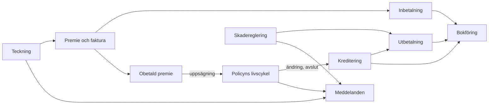

# Affärsprocesser och affärsregler

Här beskrivs Petvolds affärsprocesser, steg för steg, och reglerna som styr dem. Varje regel har ett id, till exempel `OBET-02`, så att den går att hänvisa till och söka efter. Varje regel anger också varifrån den kommer: en lag, ett beslut (ADR) eller en inställning.

Funktionssidorna beskriver hur funktionerna används och ställs in. Den här delen beskriver vad som händer och varför.

## Processerna

| Process | Från och till | Regler |
| --- | --- | --- |
| [Teckning](teckning.md) | En kund ansöker, reglerna bedömer och en policy tecknas till tariffens pris | `TECK` |
| [Policyns livscykel](policyns-livscykel.md) | Ändring, förnyelse, ny ägare, dödsfall, avslut och återkallelse | `POL` |
| [Skadereglering](skadereglering.md) | En skada anmäls, bedöms, kompletteras, beslutas och attesteras | `SKADA` |
| [Premie och faktura](premie-och-faktura.md) | En policy tecknas eller förnyas, och kunden får en faktura | `PREM` |
| [Inbetalning](inbetalning.md) | Pengar kommer in på bolagets konto och kopplas till en faktura | `BET` |
| [Obetald premie](obetald-premie.md) | En faktura betalas inte: påminnelse, uppsägning och avslut | `OBET` |
| [Kreditering och tillgodohavanden](kreditering-och-tillgodohavanden.md) | Premien sänks, en faktura krediteras eller skrivs av, och ett tillgodohavande används eller betalas tillbaka | `KRED` |
| [Utbetalning](utbetalning.md) | En ersättning eller en återbetalning betalas ut till kunden eller kliniken | `UTB` |
| [Bokföring](bokforing.md) | Varje händelse med pengar blir en verifikation, och varje dag stängs | `BOK` |
| [Meddelanden till kunden](meddelanden.md) | Beskeden lagen kräver: vilka, till vem, när och med vad | `MEDD` |
| [Personuppgifter](personuppgifter.md) | Lagringstid, gallring, radering och begränsning | `PERS` |

Funktionssidorna beskriver samma sak från andra hållet: hur det görs i API:t och hur det ställs in. Se [översikten](../funktion/README.md).

## Hur processerna hänger ihop

## Läsa en regel

| Fält | Betyder |
| --- | --- |
| Id | Processens prefix och ett nummer. Ett id byts aldrig. En regel som tas bort behåller sitt id med anteckningen *upphävd*. |
| Regel | Vad som gäller, kort |
| Källa | Lagen, beslutet (ADR) eller inställningen regeln kommer från |
| Inställning | Om bolaget kan ändra den, och var |
