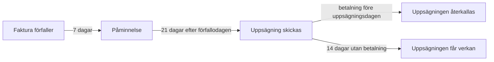

# Obetald premie

En faktura som inte betalas får en påminnelse. Hjälper inte den sägs policyerna på fakturan upp, och uppsägningen får verkan fjorton dagar senare om premien inte betalas.

**Roller:** körningen `billing.dunning` påminner och säger upp. Policymodulen registrerar uppsägningen. Kunden får meddelandena.

## Flödet

1. **Sju dagar efter förfallodagen** får en obetald faktura en påminnelse, med händelsen `invoice.overdue` och meddelandet `payment-reminder`.
2. **21 dagar efter förfallodagen** sägs varje policy på fakturan upp för obetald premie. Uppsägningen registreras när den skickas, med verkan fjorton dagar senare, och kunden får beskedet med lagrum.
3. **Betalas premien före uppsägningsdagen** har uppsägningen ingen verkan, och `billing` återkallar den. Delbetalningarna kommer tillbaka.
4. **Betalas den inte** får uppsägningen verkan. Det som är obetalt för tiden policyn gällde står kvar och kan skrivas av (KRED-08).

## Regler

| Id | Regel | Källa | Inställning |
| --- | --- | --- | --- |
| OBET-01 | En obetald faktura får en påminnelse när den varit förfallen marknadens antal dagar, en gång. | ADR 0040, punkt 7 | Marknadens `reminderAfterDays`, 7 i Sverige |
| OBET-02 | Policyerna på en faktura som fortfarande är obetald sägs upp när den varit förfallen marknadens antal dagar, och aldrig utan att påminnelsen skickats först. | ADR 0040, punkt 7 | Marknadens `cancellationNoticeAfterDays`, 21 i Sverige |
| OBET-03 | En sen påminnelse ger kunden samma tid: uppsägningen kommer tidigast lika många dagar efter påminnelsen som mellan de två reglerna. | ADR 0040, punkt 7 | – |
| OBET-04 | Uppsägningen får verkan fjorton dagar efter att den skickades. | FAL 5 kap. 2 § | Policymodulens marknadsprofil, `unpaidPremiumNoticeDays` |
| OBET-05 | Betalas premien före den dag uppsägningen får verkan har den ingen verkan, och den återkallas. En betalning på dagen eller senare ändrar inget. | FAL 5 kap. 2 § | – |
| OBET-06 | Alla policyer på fakturan sägs upp, också vid en delbetalning. En policy som inte kan sägas upp, till exempel redan avslutad, hoppas över med skälet. | ADR 0040, förtydligande 2026-11-23 | – |
| OBET-07 | Kan återkallelsen inte göras, till exempel för att något hänt med policyn efter uppsägningen, sparas det, och en person tar det. | ADR 0040, punkt 7 | – |
| OBET-08 | Ett tillgodohavande betalar obetalda fakturor före påminnelserna, så att ingen påminns om det som redan är täckt. | ADR 0040, punkt 6 | – |
| OBET-09 | Påminnelseavgift och dröjsmålsränta tas inte ut än. En avgift kräver att villkoren har den, och aldrig över marknadens tak. | ADR 0040, punkt 7, räntelagen 6 §, lagen om ersättning för inkassokostnader 2 § | – |
| OBET-10 | Inkasso sker inte i Petvold. | ADR 0040, punkt 7 | – |

## Exempel

En faktura förfaller den 5 december. Den 12 december skickas en påminnelse (OBET-01). Den 26 december sägs policyn upp med verkan den 9 januari (OBET-02, OBET-04). Kunden betalar den 2 januari, och uppsägningen återkallas (OBET-05).

## Mer

- [Premier och betalningar](../funktion/premier.md#obetald-premie): stegen på fakturan och API:t
- [Policyer](../funktion/policyer.md): uppsägning och återkallelse
- [Körningar](../funktion/korningar.md): `billing.dunning`
