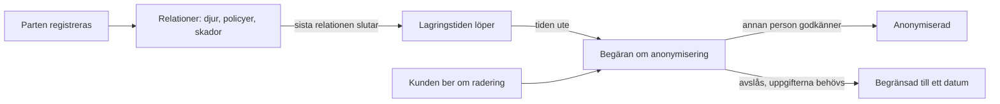

# Personuppgifter

Personuppgifter om kunder sparas så länge relationen kräver det och lagen tillåter. Därefter anonymiseras de, aldrig av en person ensam. Under tiden kan behandlingen begränsas, och personnummer visas aldrig.

**Roller:** kundservice (`party-registrar`) registrerar och ändrar. Dataskyddsansvarig (`privacy-officer`) begär, godkänner och avslår radering och ställer in lagringstiden. Körningen `retention-job` hittar parter vars lagringstid gått ut.

## Flödet

## Regler

| Id | Regel | Källa | Inställning |
| --- | --- | --- | --- |
| PERS-01 | Varje ändring av en part blir en ny revision med vem, när och varför. | ADR 0026 | – |
| PERS-02 | Ett personnummer eller organisationsnummer hör till en part åt gången per land. Svenska nummer kontrolleras med datum och kontrollsiffra. | ADR 0026 | – |
| PERS-03 | Personnummer visas aldrig i svar och står aldrig i en adress. Sökning sker i anropets innehåll. | GDPR artikel 5.1 c och f, ADR 0026 | – |
| PERS-04 | Ett felaktigt nummer tas bort med ett skäl och finns kvar i historiken, maskerat. | ADR 0039 | – |
| PERS-05 | En avliden person eller en upplöst organisation avslutas. En försäkringstagare med en policy som löper kan inte avslutas. En avslutad part kan inte bli försäkringstagare eller ägare igen. | ADR 0039 | – |
| PERS-06 | Lagringstiden är ett antal hela år efter partens sista relation, per marknad. Petvold föreslår tio år i Sverige. En marknad utan regel gallras aldrig automatiskt. | FAL 7 kap. 4 §, bokföringslagen 7 kap. 2 §, ADR 0028 | Lagringstiden per marknad |
| PERS-07 | Den sista relationen är den senaste av: partens senaste ändring, slutet på ett ägarskap, slutet på en policy som försäkringstagare, och en skada som togs emot eller beslutades på en sådan policy. | ADR 0028 | – |
| PERS-08 | Ett djur parten äger, en policy som gäller eller en skada som inte är färdigbeslutad stoppar gallringen helt. | ADR 0028 | – |
| PERS-09 | En anonymisering kräver två personer: en som begär och en annan som godkänner. | ADR 0028 | – |
| PERS-10 | Anonymisering tar bort namn, födelsedatum, kontaktuppgifter, adress, språk, motiveringar och id-nummer i alla revisioner. Id, sort och marknad finns kvar, så att policyer och beslut fortfarande hänger ihop. Det går inte att ångra. | GDPR artikel 17, ADR 0028 | – |
| PERS-11 | Måste uppgifterna sparas trots en begäran, till exempel för ett skadeärende inom tioårsgränsen, begränsas parten till ett datum. En begränsad part syns bara för den med `parties:privacy`. | GDPR artikel 17.3 och 18 | – |
| PERS-12 | En begränsad eller anonymiserad part kan inte bli försäkringstagare eller ny ägare till ett djur. | ADR 0028 | – |
| PERS-13 | Motiveringar och skäl får inte innehålla personuppgifter. | ADR 0028 | – |
| PERS-14 | Efter en återställning från säkerhetskopia körs alla godkända anonymiseringar igen, innan systemet öppnas. | ADR 0028 | `npm run erasures:reapply` |
| PERS-15 | Priset sparar zonen, inte postnumret. Meddelanden har id, inte namn och adress. Händelser till bolagets system har inga fritexter. | GDPR artikel 5.1 c, ADR 0032, ADR 0033 | – |
| PERS-16 | Fakturor, betalningar och verifikationer sparas i sju år och raderas inte vid en begäran om radering. Betaluppgifter raderas inte än när en part anonymiseras. | Bokföringslagen 7 kap. 2 §, ADR 0040, punkt 11 | – |

## Exempel

Anna sålde sin sista hund den 1 juni 2015 och har inga policyer eller skador kvar. Med tio år går lagringstiden ut den 1 juni 2025 (PERS-06, PERS-07). Nästa gallringskörning skapar en begäran om anonymisering, och en dataskyddsansvarig som inte är den som begärde godkänner den (PERS-09). Anna finns kvar som en anonymiserad part (PERS-10).

## Mer

- [Parter](../funktion/parter.md#radering-och-begränsning-adr-0028): radering, begränsning och gallring i API:t
- [ADR 0028](../adr/0028-gallring-och-anonymisering.md) och [ADR 0039](../adr/0039-partens-livscykel.md)
