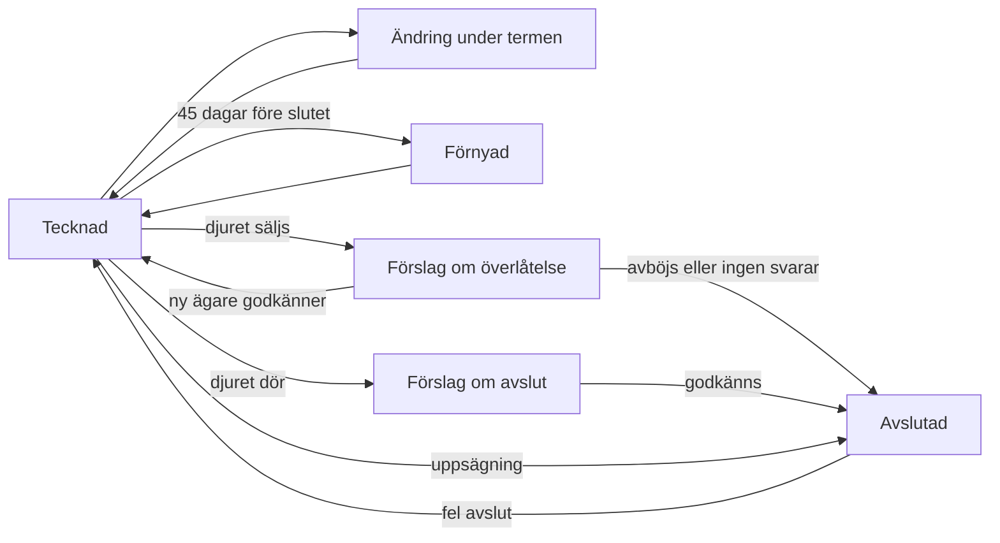

# Policyns livscykel

En policy ändras, förnyas, går över till en ny ägare och avslutas. Varje ändring blir nya versioner med två tidsaxlar, så att det alltid går att se vad som gällde en dag och vad som var känt vid en tidpunkt. Skador som berörs omprövas.

**Roller:** kundservice (`policy-registrar`) ändrar och avslutar. Körningar förnyar och avslutar det som inte besvarats. Djurregistret säger när ett djur säljs eller dör.

## Flödet

## Regler för ändring

| Id | Regel | Källa | Inställning |
| --- | --- | --- | --- |
| POL-01 | En policy ändras aldrig på plats. Varje ändring blir nya versioner med giltighetstid och registreringstid, och de gamla finns kvar i historiken. | ADR 0006 | – |
| POL-02 | En ändring av valen gäller från i dag eller senare, aldrig bakåt, och bara i den senaste termen. | ADR 0029 | – |
| POL-03 | De nya valen ska finnas i termens produktversion. Premien räknas för hela termen med de nya valen, och dagarna som är kvar räknas med den nya premien. | ADR 0029, ADR 0030 | – |
| POL-04 | Skador bedöms mot den version som gällde på behandlingsdagen: före ändringsdagen med de gamla valen, från den med de nya. | ADR 0006, ADR 0018 | – |

## Regler för förnyelse

| Id | Regel | Källa | Inställning |
| --- | --- | --- | --- |
| POL-05 | En policy förnyas på samma villkor om ingen sagt upp den. | FAL 3 kap. 4 § | – |
| POL-06 | Förnyelsekörningen förnyar policyer vars term slutar inom framförhållningen. Nästa term börjar dagen den förra slutar. | ADR 0029 | Produktens `renewalLeadDays`, förval 45 |
| POL-07 | Den nya termen får den version av produkten som säljs på förnyelsedagen, samma val, och priset från tariffen den dagen med djurets nya ålder. Kampanjer för nya policyer gäller inte. | ADR 0029, ADR 0030 | – |
| POL-08 | En policy som inte kan förnyas automatiskt listas med orsak och förnyas av en person: produkten säljs inte, valet eller arten finns inte, termen är för lång, djuret har dött, försäkringstagaren saknas eller priset kan inte räknas. | ADR 0029 | – |
| POL-09 | Kunden får ett förnyelsebesked med det som ändrats mot förra termen. | FAL 2 kap. 5–6 §§, 3 kap. 5 § | – |

## Regler när djuret säljs eller dör

| Id | Regel | Källa | Inställning |
| --- | --- | --- | --- |
| POL-10 | En försäljning eller ett dödsfall i djurregistret blir ett förslag för den policy som gäller den dagen, ett förslag per händelse. | ADR 0029 | – |
| POL-11 | Vid en försäljning tar den nya ägaren över samma policy från försäljningsdagen när hen godkänt villkoren. Karenstid, självriskperioder och förbrukat försäkringsbelopp följer med. | ADR 0029 | – |
| POL-12 | Den nya ägaren har till försäljningsdagen, eller i dag om den är senare, plus produktens antal dagar på sig. Ingen som svarar, eller ett avböjande, avslutar policyn från försäljningsdagen. | ADR 0029 | Produktens `transferAcceptanceDays`, förval 30 |
| POL-13 | Premien för dagarna efter försäljningen flyttas från den förra ägaren till den nya. | ADR 0029, ADR 0040 | – |
| POL-14 | En policy i en grupp lämnar gruppen vid en överlåtelse, i samma transaktion. | ADR 0007 | – |
| POL-15 | Ett godkänt förslag om avslut vid dödsfall avslutar policyn från dödsdagen med premie tillbaka. Ett avböjt förslag ändrar inget. | FAL 3 kap. 6 § | – |

## Regler för avslut

| Id | Regel | Källa | Inställning |
| --- | --- | --- | --- |
| POL-16 | Kunden kan alltid säga upp till termens slut. | FAL 3 kap. 3 § | – |
| POL-17 | Kunden kan säga upp med verkan dagen efter bara om produkten tillåter det. | FAL 3 kap. 3 § | Produktens `midTermCancellation` |
| POL-18 | Kunden kan ångra sig inom 14 dagar från tecknandet. Policyn upphör dagen efter, eller från start om den inte börjat gälla. | Distansavtalslagen 3 kap. 13 § | – |
| POL-19 | När behovet faller bort, till exempel när djuret dör, upphör policyn från den dagen, också bakåt i tiden, med en anteckning. | FAL 3 kap. 6 § | – |
| POL-20 | Bolaget säger upp till termens slut minst en månad före, och vid grovt åsidosättande med verkan 14 dagar efter att uppsägningen skickades. | FAL 3 kap. 3 och 7 §§ | – |
| POL-21 | Vid obetald premie gäller uppsägningen 14 dagar efter att den skickades (se [Obetald premie](obetald-premie.md)). | FAL 5 kap. 2 § | Marknadens `unpaidPremiumNoticeDays` |
| POL-22 | Premien för dagarna som inte längre gäller betalas tillbaka per dag, avrundat till närmaste öre. | FAL 5 kap. 6 § | – |
| POL-23 | Ett nytt avslut som börjar samma dag som ett tidigare eller senare avvisas. Ett tidigare avslut går, till exempel om djuret dör under uppsägningstiden. | ADR 0029 | – |
| POL-24 | Bara det senaste avslutet kan återkallas, och då gäller de ersatta versionerna igen och premien tillbaka återkallas. | ADR 0029 | – |
| POL-25 | Ett sent besked om bolagets uppsägning flyttar inte upphörandedagen automatiskt. En person avgör om dagen håller. | ADR 0032 | – |
| POL-26 | När versioner ersätts omprövas varje skada vars senaste beslut fattades på en ersatt version, och bara skillnaden bokförs. | ADR 0018, ADR 0029 | – |

## Exempel

Rex dör den 1 mars 2027, och Anna hör av sig den 20 mars. Kundservice avslutar policyn med skälet att behovet fallit bort från den 1 mars (POL-19). Premien för 1 mars till 1 december betalas tillbaka per dag (POL-22). En skada från den 10 mars som redan ersatts omprövas och avslås, och utbetalningen bokas tillbaka (POL-26). Visar det sig att det var fel djur återkallas avslutet, och skadan omprövas och godkänns igen (POL-24).

## Mer

- [Policyer](../funktion/policyer.md): ändring, förnyelse, förslag, grupper och avslut i API:t
- [Kreditering och tillgodohavanden](kreditering-och-tillgodohavanden.md): vad ett avslut gör med fakturorna
- [ADR 0029](../adr/0029-policyns-livscykel.md) och [ADR 0006](../adr/0006-bitemporala-policyversioner.md)
