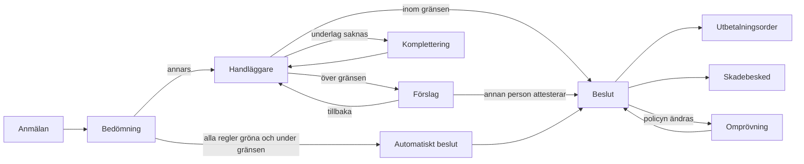

# Skadereglering

En skada anmäls av kunden eller kliniken och bedöms direkt av skademotorn. Är allt i ordning och beloppet litet beslutas den automatiskt. Annars beslutar en handläggare, och över handläggarens gräns attesterar någon annan. Ett beslut som höjer ersättningen blir en utbetalningsorder.

**Roller:** kliniken eller kundkanalen anmäler. Handläggaren (`handler`) beslutar. Attestanten (`approver`) attesterar. Kunden kan begära att en person prövar ett automatiskt beslut.

## Flödet

## Regler för anmälan och bedömning

| Id | Regel | Källa | Inställning |
| --- | --- | --- | --- |
| SKADA-01 | En skada utan id och skadenummer får dem av Petvold: marknadens prefix, året i marknadens tidszon och nästa nummer i årets serie. | ADR 0036 | `PETVOLD_CLAIM_NUMBER_PREFIX` |
| SKADA-02 | Reglerna prövas i ordning: policy finns, marknad och valuta, djuret, policyn aktiv, momentet, karenstid, diagnosen känd, förbehåll och försäkringsbelopp. Varje regel redovisas. | ADR 0018 | Produktens skaderegler |
| SKADA-03 | En skada bedöms mot policyns version på behandlingsdagen. | ADR 0006 | – |
| SKADA-04 | En behandling som började under karenstiden från policyns första dag avslås. | Villkoren | Skadereglernas karenstid |
| SKADA-05 | En diagnos som ett förbehåll undantar avslås. En diagnos i samma grupp som ett förbehåll granskas av en person. | Villkoren, ADR 0031 | Policyns förbehåll |
| SKADA-06 | Ersättningen räknas så: fakturerat, minus det som aldrig ersätts, minus moms om den inte ersätts, minus fast självrisk, minus rörlig självrisk, högst det som återstår av årets försäkringsbelopp. | Villkoren | Produktens skaderegler |
| SKADA-07 | Den fasta självrisken dras när ingen självriskperiod är öppen för djuret och diagnosgruppen, och aldrig mer än underlaget. | Villkoren | Produktens självriskperiod |
| SKADA-08 | Den rörliga självrisken avrundas till närmaste öre, halvt uppåt. | ADR 0005 | – |
| SKADA-09 | Förbrukat försäkringsbelopp räknas ur bokföringen per djur, moment, år och valuta. Det finns ingen separat räknare. | ADR 0018 | – |

## Regler för beslut

| Id | Regel | Källa | Inställning |
| --- | --- | --- | --- |
| SKADA-10 | En skada beslutas automatiskt när alla regler är godkända eller information, förslaget inte är avslag och ersättningen är högst produktens gräns. | ADR 0018 | Produktens `autoSettleMax` |
| SKADA-11 | En skada som går till handläggare får en reserv för den förväntade ersättningen, som beslutet löser upp. | ADR 0019 | – |
| SKADA-12 | Ett beslut fattas mot en bedömnings kontrollsumma. Har underlaget ändrats sedan dess avvisas beslutet. | ADR 0018 | – |
| SKADA-13 | Ett avslag mot ett förslag om ersättning kräver `claims:override`, en skälskod och en motivering, och märks som avvikelse. | ADR 0018 | – |
| SKADA-14 | En ersättning över handläggarens gräns blir ett förslag som en annan person attesterar. Den som föreslog får aldrig attestera själv. | ADR 0019 | Rollens beslutsgräns |
| SKADA-15 | Ett ärende har högst ett öppet förslag. Vid attesten måste underlaget vara detsamma som i förslaget. | ADR 0019 | – |
| SKADA-16 | Ett avslag, ett automatiskt beslut och en omprövning kräver aldrig attest. | ADR 0019 | – |
| SKADA-17 | Varje beslut sparar hela underlaget, regelversionen, beräkningsmodellen och Petvolds version, och kan räknas om till samma resultat. | ADR 0018 | – |
| SKADA-18 | Ett beslut som höjer ersättningen ger en utbetalningsorder på ökningen. En sänkning ger ett förslag till återkrav på minskningen, och inget dras tillbaka av sig självt (`UTB-12`). | ADR 0019, ADR 0040 | – |

## Regler för komplettering

| Id | Regel | Källa | Inställning |
| --- | --- | --- | --- |
| SKADA-19 | En handläggare kan begära underlag av kunden eller kliniken, en öppen begäran per mottagare. Ärendet kan inte beslutas medan den är öppen. | ADR 0036 | – |
| SKADA-20 | En påminnelse markeras på påminnelsedagen, och begäran går ut dagen efter svarsdatumet. | ADR 0036 | Skadereglernas `informationRequest.reminderAfterDays` (14) och `expiresAfterDays` (30) |
| SKADA-21 | En utgången begäran avslår inte ärendet. Det går tillbaka till handläggaren med en markering, och bara en person får sätta ned ersättningen på den grunden. | FAL 7 kap. 2 § | – |
| SKADA-22 | Ersättningen ska betalas senast en månad efter att underlaget var komplett. Tiden räknas från när ärendet togs emot, när underlaget kom in eller när begäran gick ut. | FAL 7 kap. 1 § | – |
| SKADA-23 | Kunden får meddelanden när en begäran görs, påminns och går ut. En begäran till kliniken ger inget meddelande. | ADR 0032, ADR 0036 | Bolagets avstängda typer |

## Regler för rättelse, stängning och prövning

| Id | Regel | Källa | Inställning |
| --- | --- | --- | --- |
| SKADA-24 | Behandlingsdagar, diagnos, fakturarader och kanal kan rättas med ett skäl och blir en ny revision. Policy, djur, marknad och valuta kan inte rättas. | ADR 0036 | – |
| SKADA-25 | Rättas ett ärende som en person beslutat öppnas det igen för en person. Maskinen ersätter aldrig en persons bedömning. | ADR 0036 | – |
| SKADA-26 | Ett ärende kan återkallas eller avvisas bara före ett beslut. En avvisning är inte ett avslag och ger inget besked. | ADR 0036 | – |
| SKADA-27 | Bilagor är adresser och kontrollsummor i bolagets arkiv och ändras aldrig. Beslutet sparar vilka som gällde. | ADR 0036 | – |
| SKADA-28 | Ett automatiskt beslut är märkt, har en förklaring som byggs av det sparade underlaget, och kunden kan begära att en person prövar det. Prövningen är nästa beslut av en handläggare. | GDPR artikel 13–15 och 22, ADR 0018 | – |
| SKADA-29 | Varje beslut, också en omprövning, blir ett skadebesked till försäkringstagaren på den första behandlingsdagen. | FAL 7 kap. 1 §, ADR 0036 | Bolagets text `review` |

## Exempel

Bella opereras för korsbandet och fakturan är på 18 640 kr, varav 420 kr för foder. Underlaget blir 18 220 kr. Fast självrisk 2 000 kr och rörlig 25 % ger 12 165 kr (SKADA-06). Bella har ett förbehåll för hälta i samma diagnosgrupp, så regeln granskas av en person (SKADA-05), och beloppet är över gränsen för automatiskt beslut (SKADA-10). Handläggarens gräns är 10 000 kr, så beslutet blir ett förslag (SKADA-14). En attestant godkänner, beslutet bokförs med båda namnen, och en utbetalningsorder på 12 165 kr skickas (SKADA-18).

## Mer

- [Skadereglering](../funktion/skadereglering.md): reglerna, beräkningen och API:t
- [Utbetalning](utbetalning.md): vad som händer med utbetalningsordern
- [ADR 0036](../adr/0036-skadeprocessen.md), [ADR 0018](../adr/0018-beslutsmotor-och-beviskedja.md) och [ADR 0019](../adr/0019-attestkedja-och-utbetalningsorder.md)
