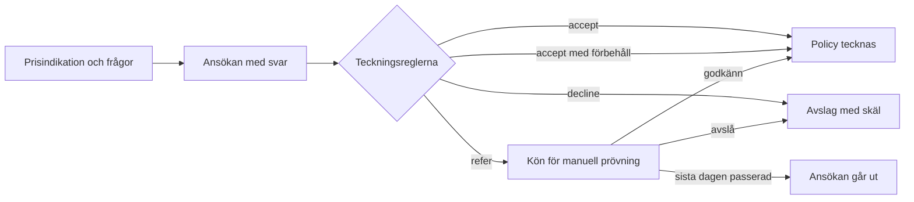

# Teckning

En kund ansöker om en försäkring för sitt djur. Priset räknas med tariffen, hälsofrågorna prövas mot teckningsreglerna, och ansökan godkänns, går till manuell prövning eller avslås. Ett godkännande blir en policy i samma transaktion.

**Roller:** säljkanalen eller kundservice (`policy-registrar`) skickar ansökan. Teckningsreglerna bedömer. En person med rollen `underwriter` prövar det som reglerna skickar vidare.

## Flödet

1. **Prisindikation och frågor.** Kanalen hämtar hälsofrågorna för produkten och arten, och visar priset och vad svaren leder till. Inget sparas.
2. **Ansökan** skickas med djur, försäkringstagare, produktversion, startdag, val, kundens godkännande och svaren.
3. **Kontrollerna** är desamma som vid tecknande: djuret, försäkringstagaren, produkten, valen, startdagen och dokumenten kunden fick se.
4. **Teckningsreglerna** som gäller på ansökningsdagen prövar art, ålder, ras och varje svar. Det strängaste utfallet vinner.
5. **Godkänd** ansökan blir en policy direkt. **Manuell prövning** väntar i kön. **Avslag** sparas med skälen, och kunden får ett besked.
6. **Policyn** får premien från tariffen och prisvillkoren, och premieplanen görs ([Premie och faktura](premie-och-faktura.md)). Kunden får försäkringsbrevet ([Meddelanden](meddelanden.md)).

## Regler för ansökan och policy

| Id | Regel | Källa | Inställning |
| --- | --- | --- | --- |
| TECK-01 | En produkt med teckningsregler tecknas bara genom en ansökan med svar på hälsofrågorna. En produkt utan regler tecknas direkt. | ADR 0031 | Produktens `underwritingSeries` |
| TECK-02 | Djuret ska finnas i marknaden och leva. Försäkringstagaren ska finnas i marknaden och får inte vara begränsad, anonymiserad eller avslutad. | ADR 0028, ADR 0039 | – |
| TECK-03 | Produktversionen ska säljas på startdagen, i marknaden och för djurets art. Valen ska finnas i produkten, och ett utelämnat val ger produktens förval. | ADR 0023 | Produktversionen |
| TECK-04 | Startdagen ligger inte före dagen för tecknandet och inte mer än produktens gräns efter den. | ADR 0029 | Produktens `policy.maxStartAheadDays`, förval 90 |
| TECK-05 | Ett djur har högst en policy för samma dag. | ADR 0007 | – |
| TECK-06 | En term är högst så lång som marknaden tillåter, i Sverige ett år. | FAL 3 kap. 2 § | Produktens `policy.termMonths`, förval 12 |
| TECK-07 | Kundens godkännande sparas med kanal, referens och tid. Tiden får ligga högst fem minuter efter Petvolds klocka. | ADR 0031 | – |
| TECK-08 | Har produkten dokument ska godkännandet ange villkoren och förköpsinformationen kunden fick se, med kontrollsumma. Ett dokument produkten inte har avvisas. | FAL 2 kap. 2 §, distansavtalslagen 3 kap. 4–5 §§, ADR 0032 | Produktens dokument |
| TECK-09 | Karenstiden räknas från policyns första dag (`inceptionDate`), som aldrig ändras, inte heller vid förnyelse. | ADR 0006 | – |

## Regler för bedömningen

| Id | Regel | Källa | Inställning |
| --- | --- | --- | --- |
| TECK-10 | Teckningsreglerna som gäller på ansökningsdagen används, och deras version sparas med ansökan. | ADR 0018, ADR 0031 | Regelserien |
| TECK-11 | En art som reglerna inte har åldersgränser för avslås (`species-not-covered`). Ålder under lägsta antal dagar eller över högsta antal år på startdagen avslås. Gränserna gäller nya försäkringar, inte förnyelse. | ADR 0031 | `ageLimits` |
| TECK-12 | Alla frågor för arten besvaras en gång. Ett ja på en diagnosfråga kräver diagnoskoder. | ADR 0031 | `questions` |
| TECK-13 | Alla regler prövas och det strängaste utfallet vinner: avslag före manuell prövning, före förbehåll, före godkänd. | ADR 0031 | `answerRules`, `breedRules` |
| TECK-14 | Ett förbehåll undantar de diagnoser kunden angav och de regeln listar. Det gäller från startdagen och följer med vid förnyelse. | ADR 0031 | `answerRules` |
| TECK-15 | Ett avslag har alltid skälskoder, och sökanden får ett besked om skälen och hur beslutet prövas. | FAL 3 kap. 1 §, 7 kap. 6 § | Bolagets text `review` |
| TECK-16 | Underlaget sparas: djurets uppgifter som de var, startdagen, svaren, utfallet, varje kontroll och reglernas version. Samma underlag ger samma utfall. | ADR 0018, FAL 4 kap. 2 § | – |

## Regler för manuell prövning

| Id | Regel | Källa | Inställning |
| --- | --- | --- | --- |
| TECK-17 | En ansökan i kön beslutas en gång, av en person med `policies:underwrite`, alltid med motivering. Ett avslag kräver en skälskod. | ADR 0031 | – |
| TECK-18 | Ett godkännande tecknar till premien kunden ansökte till. Ger tariffen ett annat pris i dag sparas kundens pris som manuellt pris med ansökan som skäl. | ADR 0030, ADR 0031 | – |
| TECK-19 | En ansökan som inte beslutats före sista dagen går ut och kan inte beslutas. | ADR 0031 | Produktens `policy.applicationExpiryDays`, förval 30 |
| TECK-20 | Kunden kan återkalla en ansökan som väntar. | ADR 0031 | – |

## Regler för priset

| Id | Regel | Källa | Inställning |
| --- | --- | --- | --- |
| TECK-21 | Grundpriset är grundpremien för art och försäkringsbelopp gånger faktorer för ålder, ras, självrisk och zon, minst lägsta premie, avrundat på slutet. All räkning sker med heltal. | ADR 0030 | Tariffen |
| TECK-22 | Åldern är djurets ålder i hela år på termens första dag. Zonen kommer från försäkringstagarens postnummer, längsta prefix först. | ADR 0030 | Tariffens `ageBands`, `zones` |
| TECK-23 | Grupprabatt och kampanj läggs ihop, aldrig över taket, och priset blir aldrig lägre än lägsta premie. | ADR 0030 | Prisvillkorens `groupDiscounts`, `campaigns`, `maxTotalDiscountBp` |
| TECK-24 | Ett pris som skiljer sig från tariffens kräver `policies:price-override` och en motivering. Det beräknade priset sparas bredvid. | ADR 0030 | – |
| TECK-25 | Postnumret sparas aldrig med priset, bara zonen. | GDPR artikel 5.1 c | – |

## Exempel

Lena ansöker om en försäkring för Kajsa på `SE-HUND-PLUS@2026.1` och svarar ja på tidigare sjukdom med öroninflammation (`ORA-OTIT`). Reglerna ger ett förbehåll (TECK-14) och ingen avslagsregel slår till, så ansökan godkänns med förbehåll (TECK-13). Policyn tecknas i samma transaktion, med förbehållet för `ORA-OTIT` på första termen. Rocky har symtom som ingen veterinär har undersökt och hamnar i kön, med sista dag 30 dagar senare (TECK-19). Sixten är 12 år och avslås med skälet `too-old` (TECK-11).

## Mer

- [Teckning](../funktion/teckning.md): teckningsreglerna, ansökan och kön i API:t
- [Pris](../funktion/pris.md): tariffen och prisvillkoren
- [Policyer](../funktion/policyer.md#teckna-en-policy): tecknandet
- [ADR 0031](../adr/0031-teckningsregler-och-ansokan.md) och [ADR 0030](../adr/0030-tariff.md)
