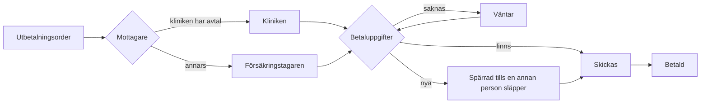

# Utbetalning

En ersättning från ett skadebeslut eller en återbetalning av ett tillgodohavande betalas ut till kunden. Har kliniken avtal om direktreglering betalas ersättningen till kliniken.

**Roller:** skademotorn beslutar och gör en utbetalningsorder. `payments` betalar ut. Ekonomiavdelningen ger betaluppgifter, släpper spärrade utbetalningar och gör avtal med kliniker.

## Flödet

1. **Ett beslut som höjer ersättningen** ger en utbetalningsorder (`claim.payout_ordered`). Ett tillgodohavande som betalas tillbaka ger en återbetalning (`refund.ordered`).
2. **Mottagaren** är kliniken i ordern om den har ett avtal om direktreglering den dagen, annars försäkringstagaren.
3. **Saknas betaluppgifter** väntar utbetalningen tills de kommer.
4. **Är uppgifterna nya** spärras utbetalningen tills en annan person släpper den.
5. **Betaltjänsten betalar ut**, och händelsen `payout.paid` eller `payout.failed` skickas.

## Regler

| Id | Regel | Källa | Inställning |
| --- | --- | --- | --- |
| UTB-01 | Varje order betalas ut en gång. Utbetalningens id är idempotensnyckel mot betaltjänsten. | ADR 0040, punkt 8, ADR 0017, punkt 4 | – |
| UTB-02 | Ersättningen går till försäkringstagaren den dagen ordern gjordes. | ADR 0040, punkt 8 | – |
| UTB-03 | En klinik med avtal om direktreglering som gäller den dagen får ersättningen för de skador den anmält. Två avtal för samma klinik och marknad får inte överlappa. | ADR 0040, punkt 8 | Avtal per klinik, `payments:agreements` |
| UTB-04 | Attesten är redan gjord i skadekedjan. Utbetalningen kräver ingen ny attest. | ADR 0040, punkt 8, ADR 0019 | – |
| UTB-05 | Betaluppgifter ändras aldrig. Nya ersätter de gamla från den stunden, och det sparas vem som gav dem. Kontonumret visas bara med de fyra sista siffrorna och skickas aldrig i händelser. | ADR 0040, punkt 8 | – |
| UTB-06 | Saknas betaluppgifter väntar utbetalningen och skickas när de kommer. | ADR 0040, punkt 8 | – |
| UTB-07 | Är betaluppgifterna nyare än marknadens spärr hålls utbetalningen kvar. En annan person än den som gav uppgifterna släpper den. Kommer nya uppgifter under spärren spärras den om. | ADR 0040, punkt 8 | `PETVOLD_NEW_PAYEE_HOLD_DAYS`, förval 0 |
| UTB-08 | Utan en betaltjänst som kan betala ut i marknaden gör Petvold ingen utbetalning. Ordern ligger kvar hos bolagets system. | ADR 0017 | Installationens betaltjänster |
| UTB-09 | En återbetalning av ett tillgodohavande betalas ut på samma sätt, till betalaren. | ADR 0040, punkt 8 | – |
| UTB-10 | Kvittning av obetald premie mot en ersättning görs inte än. Den ska bara göras om marknaden tillåter det och produkten slår på det. | ADR 0040, punkt 8 | – |
| UTB-11 | En utbetalning med bankfil väntar tills den har kommit med i en `pain.001` och banken bekräftat den i `camt.054`. Uttaget gör den betald, och en retur gör den misslyckad med bankens orsakskod. Varje utbetalning kommer med i en fil en gång. | ADR 0040, punkt 12 | `PETVOLD_BANK_FILE_DEBTOR_NAME` |
| UTB-12 | Ett beslut som sänker en ersättning efter att den beställts ger ett förslag till återkrav. En handläggare väljer att kräva tillbaka, avräkna mot kundens tillgodohavande (om det räcker) eller skriva av (inom sin gräns). Inget dras tillbaka av sig självt. | ADR 0040, punkt 8 | Rollens `creditLimits` |

## Exempel

Doris skada beslutas till 3 200 kr. Ordern går till Erik, som är försäkringstagare. Han gav sitt konto i går, och spärren är två dagar, så utbetalningen spärras (UTB-07). Kundtjänst gav uppgifterna, så ekonomi släpper den efter att ha ringt Erik på numret i registret. Den betalas ut, och `payout.paid` skickas utan kontonumret (UTB-05).

## Mer

- [Premier och betalningar](../funktion/premier.md#utbetalning-av-ersättning): betaluppgifter, köer och avtal i API:t
- [Skadereglering](../funktion/skadereglering.md): beslutet som ger ordern
