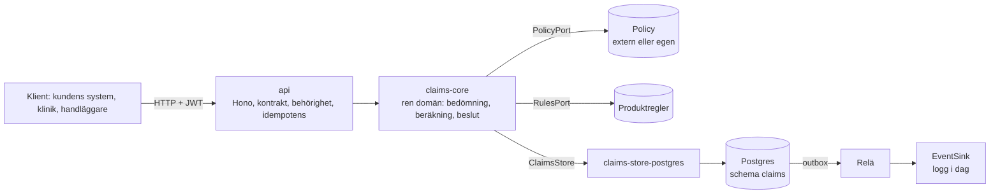

# Arkitektur

Hur Petvold är byggt och varför. Besluten bakom finns i [ADR](../adr/README.md).

## Översikt

Petvold är en modulär monolit (ADR 0001): en process och en databas per installation, men moduler med hårda gränser. En modul läser aldrig en annan moduls tabeller. Den använder modulens API, ett gränssnitt (port) eller händelser.

## Moduler i dag

| Modul | Ansvar | Beror på |
| --- | --- | --- |
| `common` | Värdetyper: `Money`, `MinorUnits`, `BasisPoints`, `ISODate`, `DateRange`, marknad och valuta (ADR 0011) | inget |
| `claims-core` | Domänen: regler, beräkning, tjänsten `ClaimsService`, portar, ledgerns kontonamn, reläet | `common` |
| `claims-store-memory` | Lagring i minnet och exempeldata, för tester och snabb utveckling | `claims-core` |
| `claims-store-postgres` | Lagring i Postgres med ren SQL (ADR 0015) och idempotensnycklar | `claims-core`, `pg` |
| `decisioning` | Regeluppsättningar, tariffer (`tariff.v1`) och prisvilkor (`price-terms.v1`, ADR 0030) med livscykel: `DecisioningService`, porten `RuleSetStore`, lagring i minnet och i Postgres (schemat `decisioning`), och `DecisioningRulesPort` som skademotorn läser regler genom (ADR 0021) | `claims-core` (typer och kontrollsumma), `pg` |
| `catalog` | Produktkatalogen: referensdata (`CatalogService`, porten `ReferenceDataStore`, ADR 0022) och produktversioner (`ProductService`, porten `ProductStore`, `vetCareTermsFor`, ADR 0023), lagring i minnet och i Postgres (schemat `catalog`), och `labelFor` som väljer etikett efter språk | `claims-core` (typer och kontrollsumma), `pg` |
| `animals` | Djurregistret: `AnimalService`, porten `AnimalStore`, lagring i minnet och i Postgres (schemat `animals`), `ownerOn` och `normalizeIdentifier` (ADR 0024). Läser referensdata via porten `ReferencePort` och parter via porten `PartyPort`. | `pg` |
| `parties` | Parter: `PartyService`, porten `PartyStore`, lagring i minnet och i Postgres (schemat `parties`), `normalizePartyIdentifier` med kontroll av svenska nummer, och `publicView` som maskerar personnummer (ADR 0026) | `pg` |
| `pricing-core` | Priset som en ren funktion: `price(tariff, input, prisvillkor)`, `validateTariff`, `validatePriceTerms`, `tariffCoverage`, `zoneFor` och `ageInYears` (ADR 0030). Ingen I/O. | inga |
| `policies` | Policyer: `PolicyService` (också skademotorns `PolicyPort`), porten `PolicyStore`, lagring i minnet och i Postgres (schemat `policies`), `MARKET_PROFILES` och `toSnapshot` (ADR 0029). Läser produkter, djur och parter via portar. | `claims-core` (typer), `pg` |
| `access` | Rollinställningen som versioner: tjänsten `AccessService`, porten `RoleConfigStore`, lagring i minnet och i Postgres (schemat `access`, ADR 0020) | `pg` |
| `api` | HTTP-lagret för hela Petvold, ett kontrakt (`openapi.yaml`, "Petvold API"): validering mot kontraktet, autentisering, behörighet, idempotens, felöversättning, språk | `claims-core`, `access`, `decisioning`, `catalog`, `animals`, `parties`, `policies`, Hono |

## Portar och adaptrar

Kärnan (`*-core`) är ren: ingen I/O, inget ramverk och inga texter för användare. Allt den behöver från omvärlden får den via gränssnitt i `claims-core/src/ports.ts`:

| Port | Ger kärnan | Implementationer |
| --- | --- | --- |
| `PolicyPort` | Policyn som den gällde ett datum, enligt det som var känt vid en tidpunkt | Minne (exempeldata). Senare policymodulen eller ett externt system. |
| `RulesPort` | Produktens skaderegler per version | Minne (exempeldata). Senare produktkatalogen. |
| `ClaimsStore` | Ärenden, beslut, självriskperioder, förbrukat belopp | Minne och Postgres. Båda klarar samma testsvit. |
| `ClaimsOutbox` | Händelser som väntar på att publiceras | Minne och Postgres |
| `EventSink` | Var reläet publicerar | Logg i dev-servern |
| `Clock`, `IdGenerator` | Tid och id:n | Fasta i tester, riktiga i drift |

En ny lagring är klar när den klarar den gemensamma sviten i `claims-core/test-suites/claims-store.ts` (ADR 0012).

## Lagring

- **Ett schema per modul** (`claims`), och varje modul ansluter med sin egen roll (`claims_service`). Rollen får läsa och lägga till, men inte ändra historik.
- **Databasen upprätthåller reglerna själv:**
  - varje journal balanserar (uppskjuten trigger)
  - självriskperioder för samma djur och grupp överlappar inte (exclusion constraint)
  - beslut och bokföring kan inte ändras eller raderas
- **Migreringar** med dbmate i `db/migrations/`. En körd migration ändras aldrig. CI provar att den senaste kan rullas tillbaka med data i tabellerna.
- **Belopp** är `bigint` i minsta enhet med suffixet `_minor`, och valutan står en gång per rad (ADR 0014).

## Beviskedja

Varje beslut sparas med sitt underlag i `claims.decision_evidence` (ADR 0018), i samma transaktion som beslutet:

| Fält | Innehåll |
| --- | --- |
| `input` | `AssessmentInput`: ärendet, policyutdraget, reglerna, öppen självriskperiod och förbrukat belopp. `sha256(canonicalJson(input))` är beslutets `inputHash`. |
| `calculation_model` | `CALCULATION_MODEL` i `assess.ts`, i dag `vet-care.v1` |
| `engine_version` | `engineVersion` i `ClaimsServiceDeps`. Dev-servern tar `PETVOLD_VERSION` eller git-commit. |

- **Databasen kräver underlaget.** En uppskjuten trigger avvisar ett beslut utan underlag vid commit, och tjänsterollen kan inte ändra eller radera underlaget.
- **Avvikelser är spärrade i databasen.** En check-constraint kräver skälkod och motivering när `deviates_from_proposal` är satt.
- **Testerna bevisar omräkningen.** `assess(evidence.input)` ger exakt den sparade bedömningen, både i minnet och efter en tur genom Postgres `jsonb`.

**Omräkning:** `replay()` i `claims-core/src/replay.ts` väljer beräkningsmodell ur `CALCULATION_MODELS`, kör det sparade underlaget och jämför med den sparade bedömningen fält för fält (JSON-pekare). Den används både av API:et (`POST /v1/claims/{id}/decisions/{seq}/replays`) och av scenariotesterna i CI ([Testning](testning.md#scenarier)). En ändring i `assess` eller `calculate` som ändrar resultatet för sparade beslut ska bli en ny beräkningsmodell, och den gamla behålls.

**Förklaring:** `explainDecision()` i `claims-core/src/explain.ts` är en ren funktion av beslutet, underlaget och ärendets begäranden om prövning. Den ger nycklar och värden, ingen text. API:et lägger till text med `localizeExplanation()` i `messages.ts`.

**Mänsklig prövning:**
- **Tabeller.** `claims.decision.automated` märker automatiska beslut. Begäranden ligger i `claims.review_request` (migration 0006). Beslutet som besvarar en begäran har `review_request_id`.
- **Stängning.** Den stängs i samma transaktion som beslutet (`DecisionCommit.closesReviewRequestId`).
- **Databasen upprätthåller reglerna:**
  - högst en öppen begäran per ärende (unikt partiellt index)
  - begäran gäller ett automatiskt beslut i samma ärende
  - den stängs en gång, av det mänskliga beslut som besvarar den (trigger)
  - ett automatiskt beslut kan inte vara en prövning (check-constraint)
- **Behörighet.** Tjänsterollen får bara uppdatera kolumnerna som stänger begäran.

**Attestkedja (ADR 0019):**
- **Tabeller.** Beslutsförslag ligger i `claims.decision_proposal` (migration 0008). Ett beslut som kommer från en attest har `approved_by` och `proposal_id`.
- **Samma transaktion.** Attesten sparar beslutet, underlaget, bokföringen, utbetalningsordern och stängningen av förslaget i en transaktion (`DecisionCommit.closesProposalId`).
- **Databasen upprätthåller reglerna:**
  - högst ett öppet förslag per ärende (unikt partiellt index)
  - förslaget överstiger alltid förslagsställarens gräns
  - attestanten är aldrig den som beslutade (check-constraints på både förslag och beslut)
  - förslaget stängs en gång, och bara stängningsfälten får ändras (trigger och kolumnrättigheter)
- **Gränser.** De räknas ut i API-lagret (`amountLimitsOf` i `permissions.ts`) och skickas till tjänsten som `decisionLimits` och `approvalLimits`. Fyraögonsprincipen och gränskontrollen ligger i `claims-core`, så att de kan testas utan HTTP (ADR 0016).

**Regeluppsättningar (ADR 0021):**
- **Tabell.** Versioner ligger i `decisioning.rule_set_version` (migration 0011), med tjänsterollen `decisioning_service`.
- **Optimistisk låsning.** Varje ändring höjer `revision`, och en uppdatering kräver föregående revision.
- **Databasen upprätthåller reglerna:**
  - publicerade versioner kan bara avvecklas, och innehållet ändras aldrig efter publicering (trigger)
  - en version i granskning är låst
  - fyra ögon (check-constraint)
  - en publicerad version per serie och datum (unikt partiellt index)
- **Skademotorn** läser regler via `RulesPort.getRules(productVersion, treatmentDate)`. `DecisioningRulesPort` översätter produktversionen till en serie med en funktion som installationen ger, normalt katalogens `ProductService.ruleSeriesOf`. Okänd produktversion ger `null`. Saknas regler svarar tjänsten `conflict`. En skada utan policy bedöms utan produktregler (`rulesVersion: 'none'`).
- **Kontrollsumma.** `rulesChecksum` (sha256 över innehåll, beräkningsmodell och datum) följer med reglerna in i underlaget och därmed i `inputHash`.

**Simulering (ADR 0018):** `simulate()` i `claims-core/src/simulate.ts` är en ren funktion. Den kör sparade underlag med andra regler genom `CALCULATION_MODELS` och jämför med besluten.
- **Underlagen** kommer från skademodulens tjänst (`decisionsForSimulation`, porten `latestDecisionsWithEvidence`). Regeln kommer från `decisioning`, och API-lagret kopplar ihop dem. Ingen modul läser den andras tabeller.
- **Filter.** API-lagret filtrerar på serie (`rulesVersion` börjar med `<serie>@`) och på anroparens omfång.
- **Index.** `claims.decision (decided_at)` (migration 0012).

**Referensdata (ADR 0022):**
- **Tabell.** `catalog.reference_item` (migration 0013) med en rad per revision. Primärnyckeln är `(kind, code, revision)`. Gällande värde är den högsta revisionen per kod (`distinct on`).
- **Bara tillägg.** Tjänsterollen `catalog_service` får `select` och `insert`, inte `update` eller `delete`. Historiken kan alltså inte skrivas om.
- **Optimistisk låsning.** En ny revision sparas bara om den är exakt nästa (`insert … where revision = max + 1`, med primärnyckeln som skydd vid samtidiga anrop).
- **Databasen upprätthåller reglerna:** en ras har en art som finns, och arten ändras aldrig (trigger). Andra sorter har ingen förälder, och en ändring har en motivering (check-constraints).
- **Upprepning är säker.** Skickas samma ändring igen returnerar tjänsten den sparade revisionen och skapar ingen ny. Därför behöver `PUT` ingen `Idempotency-Key`.
- **Språk.** `labelFor(labels, acceptLanguage)` är ren: exakt tagg, sedan språket utan region, sedan engelska, sedan första taggen i bokstavsordning. API-lagret lägger till `label` i svaret.

**Produktversioner (ADR 0023):**
- **Tabell.** `catalog.product_version` (migration 0014), med primärnyckeln `(product, version)` och samma optimistiska låsning som regeluppsättningar (`revision`).
- **Databasen upprätthåller reglerna** (trigger och check-constraints):
  - en publicerad version får bara ett tidigare `sales_to`
  - en version i granskning är låst
  - fyra ögon
  - högst en publicerad version per produkt och dag (`daterange(sales_from, sales_to) &&`)
- **Kontroller mot andra moduler.** `ProductService` får `speciesActive` och `ruleSeriesInForce` som funktioner. Installationen (dev-servern, eller `createApp` om inget anges) kopplar dem till referensdatan och till `DecisioningService.rulesInForce`.
- **Säljperioden utanför kontrollsumman.** Kontrollsumman täcker innehållet och `salesFrom`. `salesTo` kan ändras efter publicering, och varje sådan ändring sparas med vem, när och varför.

**Djurregistret (ADR 0024):**
- **Tabeller** (migration 0015 och 0016):
  - `animals.animal_revision`, med en rad per revision. Tjänsterollen får bara läsa och lägga till, och en trigger kontrollerar att marknad och art aldrig ändras.
  - `animals.animal_identifier`, med primärnyckeln `(type, value)`, så att ett nummer bara kan höra till ett djur.
  - `animals.ownership`, med en rad per ägarskap.
- **Ägarkedjan.** Ett ägarbyte är `update … set valid_to` på det öppna ägarskapet och `insert` av nästa, i en transaktion. Databasen kontrollerar resten:
  - högst ett öppet ägarskap per djur (unikt partiellt index)
  - det nya börjar samma dag som det förra slutade (trigger)
  - bara `valid_to` får uppdateras, och bara en gång (kolumnrättighet och trigger)
- **Referensdata** läses via porten `ReferencePort.get(kind, code)`. `ReferenceDataStore` i `catalog` har samma form, så installationen skickar den direkt. `animals` beror inte på `catalog`.
- **Omfång** kontrolleras i API-lagret: djurets marknad mot anroparens marknader. Roller bundna till klinik eller försäkringar ser inga hela djur.
- **Ägare** kontrolleras via porten `PartyPort.marketOf(partyId)`, som `PartyService` uppfyller. `animals` beror inte på `parties`. Utan port kontrolleras bara formatet.
- **Kullar (ADR 0027):** `animals.litter` och `animals.litter_member` (migration 0018), där `animal_id` är primärnyckel så att ett djur bara kan höra till en kull. `AnimalStore.registerLitter` sparar kullen, djuren, id-numren, ägarskapen och medlemskapen i en transaktion.
- **Uppslagning (ADR 0025):** kolumnen `allow_lookup` i `animal_revision` (migration 0016). `AnimalService.lookup` hittar djuret på id-nummer, filtrerar bort stängda djur och returnerar `summaryOf(record)` utan ägare och historik. API-lagret filtrerar på marknad men inte på bindning, eftersom svaret saknar personuppgifter.

**Parter (ADR 0026):**
- **Tabeller** (migration 0017):
  - `parties.party_revision`, med en rad per revision. En constraint kräver namnfälten som hör till sorten, och en trigger kontrollerar att sort och marknad aldrig ändras. Adressen är `jsonb`.
  - `parties.party_identifier`, med primärnyckeln `(type, country, value)`. Tjänsterollen får bara läsa och lägga till.
- **Maskering i API-lagret.** Tjänsten returnerar hela numret, eftersom andra moduler kan behöva det, och `publicView(record)` maskerar det i varje svar. Sökningen är `POST /v1/party-searches` med numret i innehållet.
- **Omfång** som för djuren: partens marknad mot anroparens marknader, och inga parter för roller bundna till klinik eller försäkringar.
- **Anonymisering (ADR 0028, migration 0019):**
  - `parties.erasure_request` och `parties.erasure_decision` får bara läsas och läggas till. En trigger stoppar ett godkännande av den som begärde.
  - Funktionen `parties.anonymize(party_id)` (`security definer`, ägd av migreringsrollen) tömmer personfälten i alla revisioner, sätter `anonymized` och tar bort id-numren. Den kräver ett godkänt beslut. `parties_service` får köra funktionen men kan inte uppdatera eller ta bort rader själv.
  - `PostgresPartyStore.decideErasure` sparar beslutet och anropar funktionen i samma transaktion.
  - En check-constraint garanterar att en anonymiserad revision saknar personuppgifter.
  - Begränsning beräknas från `restrict_until` i avslagen.
- **Gallring (ADR 0028, migration 0020):**
  - `RetentionService` i `parties/src/retention.ts` har lagringstiderna som versioner i `parties.retention_settings`. Version 1 skapas från `DEFAULT_RETENTION` första gången den läses.
  - Andra moduler rapporterar relationer via `ActivitySource.activityOf(partyId)`: pågående, ett slutdatum eller ingen. Källorna är `AnimalService.activityOf`, `PolicyService.activityOf` och `claimsActivity(policies, claims)` i `api/src/wiring.ts`. Den sista går igenom `PolicyService.holderPeriods(partyId)` och frågar `ClaimsService.claimActivity(policyId, från, till)` om skador med behandling under perioden. Skademotorn känner inte till parter.
  - `run` går igenom `PartyService.partyIds()` och skapar en begäran för varje part där `addYears(sista relation, år) < i dag`.
  - `reapplyErasures(pool)` i `postgres.ts` och skriptet `npm run erasures:reapply` kör `parties.anonymize` igen för varje godkänt beslut. `PartyService.marketOf` svarar `null` för begränsade och anonymiserade parter, så att djurregistret inte kan peka nya ägarskap på dem.

**Policyer (ADR 0006, 0029):**
- **Tabeller** (migration 0021):
  - `policies.policy`, `policies.term` och `policies.policy_transaction` får bara läsas och läggas till.
  - `policies.policy_version` är bitemporal. Tjänsterollen får bara sätta `sys_to`, en gång, och en trigger stoppar allt annat.
- **Två exclusion constraints** gäller för det som är känt nu (`sys_to is null`). En policy har aldrig två versioner för samma dag, och ett djur har aldrig två aktiva policyer för samma dag. `animal_id` kopieras därför till versionen.
- **Portar** (ADR 0001): `ProductPort`, `AnimalPort` och `PartyPort`. Adaptrarna `productPort` och `animalPort` i `api/src/wiring.ts` kopplar dem till `ProductService` och `AnimalService`, och `PartyService` passar direkt.
- **Marknadsprofilen** `MARKET_PROFILES` i koden har lagreglerna med källor. Än så länge finns bara längsta termen för Sverige.
- **Skademotorn** får `PolicyService` som `PolicyPort`. `getPolicyAt(policyId, onDate, knownAt)` hittar versionen, termen och djurets födelsedatum och bygger en `PolicySnapshot` med `toSnapshot`.
- **Gallringen** får `PolicyService.activityOf` som `ActivitySource`.
- **Avslut (migration 0022):** `PolicyService.cancel` räknar fram upphörandedagen från skälet, marknadsprofilen och produktens `midTermCancellation` (via `ProductPort`). `PolicyStore.apply(policyId, supersede, add, tx, events)` sätter `sys_to` på de ersatta versionerna och lägger till nya, i en transaktion. Samma metod används för återkallelse och kommer att användas för förnyelse och överlåtelse.
- **Outbox:** `policies.outbox` får händelserna i samma transaktion. `pendingEvents` och `markPublished` används av en relay, som i dev-servern skriver ut dem i loggen.
- **Premie tillbaka** räknas av den rena funktionen `refundFor(terms, versionerFöre, från)`.
- **Förslag (migration 0024 och 0025):**
  - Djurregistret har en egen outbox (`animals.outbox`). `AnimalService.transfer` och `correct` skriver `animal.ownership_changed` och `animal.died` i samma transaktion.
  - Installationens relay lämnar dem till `PolicyService.handleAnimalEvent`, som skapar ett förslag i `policies.proposal`. `source_event_id` är unik, så en händelse som kommer två gånger ger bara ett förslag. I dev-servern är relayn en `setInterval`.
  - `acceptProposal` för en överlåtelse delar versionerna vid försäljningsdagen och byter försäkringstagare i delen efter.
  - Ett avslut för ett dödsfall, ett avböjt förslag eller ett förslag som löpt ut går genom `cancel`.
  - Beslutet sparas i `policies.proposal_decision` i samma transaktion som ändringen (`PolicyStore.apply(…, decision)`).
- **Ändring under termen (migration 0026):** `policies.term_change` har nya val och premie från en dag. `policy_version.change_no` pekar på ändringen, med en främmande nyckel. `effectiveTerms(term, version)` ger valen och premien som en version följer. Den används av `toSnapshot`, `refundFor` och förnyelsen.
- **Grupper (migration 0027):** `policies.policy_group` och `policies.group_membership`. Medlemskapet har `from_date` och `to_date`, och ett unikt partiellt index (`where to_date is null`) gör att en policy bara är med i en grupp i taget. Tjänsterollen får bara sätta slutet, en gång. När en överlåtelse godkänns avslutas medlemskapet i den förra ägarens grupp genom `ApplyExtra.endMemberships`, i samma transaktion. `PolicyStore.apply` tar sedan den här PR:en ett objekt (`ApplyExtra`) med `terms`, `decision`, `changes` och `endMemberships`.
- **Prisindikation (ADR 0030):** `PolicyService.quote` hämtar djurets uppgifter via `AnimalPort`, postnumret via `PartyPort.postalCodeOf` och produktens `tariffSeries` via `ProductPort`. Tariffen hämtas via `TariffPort.tariffInForce`, som `DecisioningService` uppfyller. Sedan anropas `price` i `pricing-core`. Katalogen kontrollerar vid granskning att tariffen täcker produkten, via `ProductDeps.tariffProblems`, som installationen kopplar till `tariffCoverage`.
- **Pris på policyn (migration 0028):** `PolicyService.priceFor` hämtar tariffen och prisvillkoren via `TariffPort` och anropar `price`. `premiumFor` väljer tariffens pris eller ett manuellt med `CallerRights.mayOverridePrice`, som API-lagret sätter från `policies:price-override`. `placeInGroup` ger policyns plats i en grupp för grupprabatten. Resultatet sparas som `TermPricing` i `policies.term.pricing` och `policies.term_change.pricing`, med zonen i stället för postnumret.
- **Omprövning efter policyändring:** `ClaimsStore.claimsDecidedOnPolicyVersions(ids)` ger skador vars senaste beslut fattades på någon av versionerna (`claims.decision.policy_version_id`). `ClaimsService.reassessForPolicyChange` omprövar dem med `reassess`, som bara skapar ett nytt beslut om `inputHash` har ändrats. Installationens relay anropar den för varje `policy.version_superseded`. En händelse som kommer två gånger ger inget nytt beslut.
- **Förnyelse (migration 0023):** `PolicyStore.endingBetween(från, till)` ger policyer vars aktiva version slutar i perioden utan att någon version följer. `PolicyService.renewalRun` tar produktens `renewalLeadDays` via `ProductPort.offer` och den version som säljs via `ProductPort.versionOnSale`. `planRenewal` kontrollerar och bygger nästa term, och `renew` sparar den med `PolicyStore.apply(…, terms)`.

**Rollinställningen (ADR 0020):**
- **Versioner.** Modulen `access` sparar hela rollinställningen som versioner i `access.role_config` (migration 0009). Den har en egen tjänsteroll, `access_service`, som bara får läsa och lägga till.
- **Läses vid varje anrop.** API-lagret läser gällande version vid varje anrop (`AccessService.current()`), så en ändring gäller direkt.
- **Validering.** Modulen känner inte till rättigheterna. `api` skickar med sin validering (`assertRoleDefinitions`).
- **Optimistisk låsning.** En ny version sparas bara om den är exakt nästa nummer. Två samtidiga ändringar ger en vinnare och en 409.
- **Utan databas.** Utan `access` i `createApp` ligger inställningen i minnet, med `roles` som version 1.
- **Uppgradering.** `syncWithDefaults(current)` i `permissions.ts` är ren och räknar ut vad som saknas jämfört med `DEFAULT_ROLES`. Skriptet `modules/api/scripts/sync-roles.ts` (`npm run roles:sync`) visar det och sparar med `--apply` via `AccessService.change`, så samma validering och versionskontroll gäller.

## Ledgern

Varje beslut som ändrar ersättningen bokförs som en journal med fyra rader som summerar till noll:

| Konto | Belopp |
| --- | ---: |
| `limit_consumed:SEK:ani_bella:vet_care:2026-04-01` | + 150 000 |
| `limit_available:SEK:ani_bella:vet_care:2026-04-01` | − 150 000 |
| `claim_expense:SEK:clm_021877` | + 150 000 |
| `claim_payable:SEK:clm_021877` | − 150 000 |

**Reserv.** När ett ärende går till handläggare bokas den förväntade ersättningen som en reservjournal (`source_type = 'claim_reserve'`, källa = ärendet), i samma transaktion som ärendet sparas:

| Konto | Belopp |
| --- | ---: |
| `reserve_expense:SEK:clm_048213` | + 1 216 500 |
| `claim_reserve:SEK:clm_048213` | − 1 216 500 |

Beslutet löser upp hela den öppna reserven med en motsatt journal (källa = beslutet), i samma transaktion som beslutet bokförs. Det gäller också vid avslag och attest. Ett öppet förslag behåller reserven.

Kontonamnen byggs bara i `claims-core/src/ledger.ts`. Förbrukat försäkringsbelopp är saldot på `limit_consumed` för nyckeln. En omprövning bokför bara skillnaden. Ett kontos saldo läses med `getBalance(account)` i lagringsporten.

Databasen kontrollerar källan (migration 0010). En beslutsjournal pekar alltid på ett beslut i samma ärende. En reservjournal pekar på ärendet eller på ett beslut i det.

## Händelser

Händelser skrivs till `claims.outbox` i samma transaktion som ändringen (ADR 0008). Ett relä läser outboxen i ordning, publicerar och markerar händelserna som publicerade. Leveransen sker minst en gång, så mottagare måste tåla dubbletter. Bara ett relä per outbox åt gången.

## API

- **Kontraktet först** (ADR 0002). `modules/api/openapi.yaml` är källan. Anrop valideras mot schemat, och `lint:openapi` kontrollerar att kontrakt och kod har exakt samma operationer.
- **Fel** som `application/problem+json` (RFC 9457).
- **Idempotens:** anrop som skapar något kräver `Idempotency-Key`. Svaret sparas per anropare och nyckel, i Postgres när dev-servern kör mot databasen.
- **Språk:** regelskäl är koder som översätts efter `Accept-Language` (`messages.ts`).
- **Behörighet (ADR 0016):** varje operation har en rättighet i kontraktet (`x-permission`). En middleware hittar operationen som matchats, läser rättigheten ur kontraktet och jämför med anroparens roller (`permissions.ts`). Rättigheterna står inte i koden. `createApp` vägrar starta om en operation saknar giltig rättighet eller om rollinställningen har en okänd rättighet, och `lint:openapi` stoppar samma fel i CI. Se [Behörighet](../funktion/behorighet.md).
- **Omfång (ADR 0016 del 2):**
  - **Var omfånget räknas ut.** Samma middleware räknar ut anroparens omfång (`scopeOf` i `permissions.ts`) ur tokenens `markets`, `clinicId` och `policyIds` och rollernas `bindsTo`.
  - **Ärenden.** En andra middleware på `/v1/claims/:claimId/*` läser ärendet och svarar 404 om det ligger utanför omfånget (`coversClaim`). Alla anrop på ett ärende går därför genom samma kontroll, även nya.
  - **Anmälan, förhandsbesked och försäkringsbelopp** kontrolleras i sina handlers.
  - **Klinik-id.** Klinikens id sparas på ärendet från tokenen (`claims.claim.clinic_id`, migration 0007).
  - **Kontrollen ligger i koden, inte i databasen** (ingen radsäkerhet, se ADR 0016). Testerna provar varje fall per roll.

## Installation

En installation per försäkringsbolag (ADR 0010), på Kubernetes med CloudNativePG (ADR 0004). Lokalt kör Postgres i docker compose med samma version (ADR 0013).
