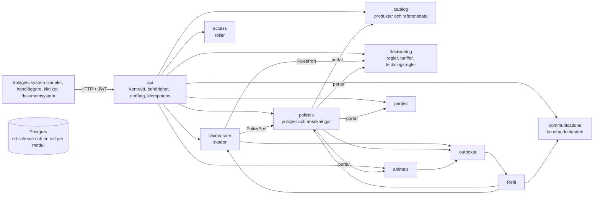

# Arkitektur

Hur Petvold är byggt och varför. Besluten bakom finns i [ADR](../adr/README.md).

## Översikt

Petvold är en modulär monolit (ADR 0001): en process och en databas per installation, men moduler med hårda gränser. En modul läser aldrig en annan moduls tabeller. Den använder modulens API, ett gränssnitt (port) eller händelser.

Modulerna talar med varandra genom portar som `composition.ts` kopplar ihop, och genom händelser via reläet. Ingen modul läser en annan moduls tabeller.

## Moduler i dag

| Modul | Ansvar | Beror på |
| --- | --- | --- |
| `common` | Värdetyper: `Money`, `MinorUnits`, `BasisPoints`, `ISODate`, `DateRange`, marknad och valuta (ADR 0011) | inget |
| `claims-core` | Domänen: regler, beräkning, tjänsten `ClaimsService`, portar, ledgerns kontonamn, reläet | `common` |
| `claims-store-memory` | Lagring i minnet och exempeldata, för tester och snabb utveckling | `claims-core` |
| `claims-store-postgres` | Lagring i Postgres med ren SQL (ADR 0015) och idempotensnycklar | `claims-core`, `pg` |
| `decisioning` | Regeluppsättningar, tariffer (`tariff.v1`), prisvilkor (`price-terms.v1`, ADR 0030) och teckningsregler (`underwriting.v1`, ADR 0031) med livscykel. Seriens sort ges av `seriesKindOf`. Delar: `DecisioningService`, porten `RuleSetStore`, lagring i minnet och i Postgres (schemat `decisioning`), och `DecisioningRulesPort` som skademotorn läser regler genom (ADR 0021) | `claims-core` (typer och kontrollsumma), `pricing-core`, `underwriting-core`, `pg` |
| `catalog` | Produktkatalogen: referensdata (`CatalogService`, porten `ReferenceDataStore`, ADR 0022) och produktversioner (`ProductService`, porten `ProductStore`, `vetCareTermsFor`, ADR 0023), lagring i minnet och i Postgres (schemat `catalog`), och `labelFor` som väljer etikett efter språk | `claims-core` (typer och kontrollsumma), `pg` |
| `animals` | Djurregistret: `AnimalService`, porten `AnimalStore`, lagring i minnet och i Postgres (schemat `animals`), `ownerOn` och `normalizeIdentifier` (ADR 0024). Läser referensdata via porten `ReferencePort` och parter via porten `PartyPort`. | `pg` |
| `parties` | Parter: `PartyService`, porten `PartyStore`, lagring i minnet och i Postgres (schemat `parties`), `normalizePartyIdentifier` med kontroll av svenska nummer, och `publicView` som maskerar personnummer (ADR 0026) | `pg` |
| `pricing-core` | Priset som en ren funktion: `price(tariff, input, prisvillkor)`, `validateTariff`, `validatePriceTerms`, `tariffCoverage`, `zoneFor` och `ageInYears` (ADR 0030). Ingen I/O. | inga |
| `billing-core` | Räkningen för pengar som rena funktioner (ADR 0040): `premiumPlan` (modellen `premium-plan.v1`) och `replayPlan`, `allocatePayment`, `distributeAdjustment` och `settleCancellation`. Ingen I/O. | inga |
| `underwriting-core` | Teckningsreglerna som en ren funktion: `underwrite(rules, input)`, `questionsFor`, `validateUnderwriting` och `underwritingCoverage` (ADR 0031). Ingen I/O. | inga |
| `policies` | Policyer: `PolicyService` (också skademotorns `PolicyPort`), porten `PolicyStore`, lagring i minnet och i Postgres (schemat `policies`), `MARKET_PROFILES` och `toSnapshot` (ADR 0029). Ansökan med teckningsregler (ADR 0031). Läser produkter, djur, parter, tariffer och teckningsregler via portar. | `claims-core` (typer), `pricing-core`, `underwriting-core`, `pg` |
| `communications` | Kundmeddelanden (ADR 0032): `CommunicationsService` gör meddelanden av policymodulens händelser, med lagrum och sista dag ur `NOTICE_RULES` per marknad, och tar emot dokumentsystemets rapporter om utskick. Porten `NoticeStore`, lagring i minnet och i Postgres (schemat `communications`). Läser policyer, ansökningar och parternas språk via portarna `PolicySource` och `PartySource`. | `common`, `pg` |
| `billing` | Premier (ADR 0040): `BillingService` gör betalarkonton och premieplaner av `policy.issued` och `policy.renewed`, med regler per marknad i `BILLING_MARKET_RULES`. Porten `BillingStore`, lagring i minnet och i Postgres (schemat `billing`). Läser produktens inställningar och försäkringstagaren via portarna `ProductSource` och `PolicySource`. | `billing-core`, `common`, `pg` |
| `webhooks` | Händelser till bolagets system (ADR 0033): `WebhookService` med prenumerationer och kön, `WebhookWorker` som skickar, `PUBLIC_EVENTS` med de fält varje händelse får ha, signaturen enligt Standard Webhooks (`sign`), `SecretBox` för hemligheterna och `fetchTransport` som vägrar privata adresser. Porten `WebhookStore`, lagring i minnet och i Postgres (schemat `webhooks`). | `pg` |
| `documents` | Dokument (ADR 0038): `DocumentService` med uppladdning, kontroll av mediatyp mot innehållet, sha256 och länkar som slutar gälla. En länk är ett slumpat id och en HMAC-signatur med `PETVOLD_DOCUMENT_KEY`, och den loggas och kan spärras. Portarna `DocumentStore` (Postgres i schemat `documents`, migration 0046, eller minnet) och `BlobStore` (`S3BlobStore` med `If-None-Match`, så att en fil aldrig skrivs över, eller minnet). `/d/{token}` ligger utanför `/v1` och kräver ingen token. Vem som får se ett dokument avgörs i API:t av det dokumentet hör till, och ett meddelandes dokument följer meddelandet. `generate` fyller en mall ur `src/templates/` (HTML och CSS med designsystemets tokens, texterna i `texts-sv.ts` och `texts-en.ts`) och skickar HTML:en till porten `PdfRenderer`. `GotenbergRenderer` ber om PDF/A-2b och PDF/UA-1 med steget `remediate`. Dokumentet sparar mall, version, kontrollsumma och data-hash (migration 0047). Med inställningen `documentMaker: petvold` gör reläet PDF:en efter `notice.created`. Det sker i `modules/api/src/notice-pdf.ts`, som också används av `POST /v1/notices/{id}/documents`. `communications` får dokumentets id och sha256 med `addDocument`, som sparar det i `communications.notice_document` och skriver `notice.document_made` i samma transaktion (migration 0048). Modulen vet bara vilka typer Petvold har mallar för, genom porten `petvoldTemplates`, och läser aldrig dokumentens tabeller. | `common`, `pg`, `@aws-sdk/client-s3` |
| `scheduling` | Körningar (ADR 0037): `Scheduler` kör körningarna när de är förfallna, per marknad och med ett lån, och sparar historiken. `dailyDue` och `timeOfDay` räknar i marknadens tidszon. Porten `SchedulingStore`, lagring i minnet och i Postgres (schemat `scheduling`). Körningarna registreras i `modules/api/src/jobs.ts`, där varje `JobRunner` har hela resultatet (`execute`), sammanfattningen till historiken (`summarize`) och sammanslagningen till de gamla anropens svar (`join`). Paus och spår finns i `scheduling.job_pause` och `scheduling.job_control` (migration 0040). Schemaändringar finns i `scheduling.job_schedule_change` och det godkända schemat i `scheduling.job_setting` (migration 0041). Databasen vägrar att samma person föreslår och godkänner, och tillåter högst en väntande ändring per körning. `effectiveSchedule` väljer det godkända schemat före förvalet. `Scheduler.health` räknar fram larmen till `/healthz`, och `onFailed` skickar `job.failed` till webhooks. | `common`, `pg` |
| `access` | Rollinställningen som versioner: tjänsten `AccessService`, porten `RoleConfigStore`, lagring i minnet och i Postgres (schemat `access`, ADR 0020) | `pg` |
| `api` | HTTP-lagret för hela Petvold, ett kontrakt (`openapi.yaml`, "Petvold API"): validering mot kontraktet, autentisering, behörighet, idempotens, felöversättning, språk | `claims-core`, `access`, `decisioning`, `catalog`, `animals`, `parties`, `policies`, `communications`, Hono |

## Portar och adaptrar

Kärnorna (`claims-core`, `pricing-core`, `underwriting-core`, `billing-core`) är rena: ingen I/O, inget ramverk och inga texter för användare. Allt de behöver från omvärlden får de via gränssnitt. Adaptrarna mellan modulerna finns i `modules/api/src/wiring.ts`, och `composition.ts` kopplar ihop dem.

**Skademotorns portar** (`claims-core/src/ports.ts`):

| Port | Ger kärnan | Implementationer |
| --- | --- | --- |
| `PolicyPort` | Policyn som den gällde ett datum, enligt det som var känt vid en tidpunkt | Policymodulen (`PolicyService`), eller ett externt policysystem. Minne i tester. |
| `RulesPort` | Produktens skaderegler per version | `DecisioningRulesPort`, som går från produktversionen till regelserien. Statiska regler i tester. |
| `ClaimsStore` | Ärenden, beslut, självriskperioder, förbrukat belopp | Minne och Postgres. Båda klarar samma testsvit. |
| `ClaimsOutbox` | Händelser som väntar på att publiceras | Minne och Postgres |
| `EventSink` | Var `relayOutbox` i `claims-core` publicerar | Används i skademotorns egna tester. Installationen använder reläet i `api` och modulen `webhooks` (ADR 0033). |
| `Clock`, `IdGenerator` | Tid och id:n | Fasta i tester, riktiga i drift |

**Portar mellan andra moduler:**

| Modul | Port | Ger | Adapter |
| --- | --- | --- | --- |
| `policies` | `ProductPort` | Produktversionen som den säljs: val, inställningar, serier och dokument | `productPort` |
| `policies` | `AnimalPort` | Djurets art, ras, födelsedag och dödsdag | `animalPort` |
| `policies` | `PartyPort` | Partens marknad och postnummer | `PartyService` direkt |
| `policies` | `TariffPort`, `UnderwritingPort` | Tariff, prisvillkor och teckningsregler som gäller | `DecisioningService` direkt |
| `catalog` | `ProductDeps` | Om arter, regelserier, tariffer och teckningsregler täcker produkten | Funktioner i `composition.ts` |
| `animals` | `ReferencePort`, `PartyPort` | Referensdata och att ägaren finns | `ReferenceDataStore`, `PartyService` |
| `parties` | `ActivitySource` | När en part senast hade en relation, för gallringen | `animals`, `policies` och `claimsActivity` |
| `communications` | `PolicySource`, `PartySource` | Policyer, transaktioner, ansökningar, förslag och partens språk | `policySource`, `partySource` |

En ny lagring är klar när den klarar modulens gemensamma testsvit i `test-suites/`, till exempel `claims-core/test-suites/claims-store.ts` (ADR 0012).

## Lagring

- **Ett schema per modul**, och varje modul ansluter med sin egen roll: `claims_service`, `access_service`, `decisioning_service`, `catalog_service`, `animals_service`, `parties_service`, `policies_service` och `communications_service`. Rollen får läsa och lägga till, men inte ändra historik. Adresserna står i `DATABASE_ENV` i `composition.ts`.
- **Databasen upprätthåller reglerna själv**, till exempel:
  - varje journal balanserar (uppskjuten trigger)
  - självriskperioder för samma djur och grupp överlappar inte (exclusion constraint)
  - beslut, bokföring, policyversioner, ansökningar och meddelanden kan inte ändras eller raderas
  - två aktiva policyer för samma djur samma dag går inte (exclusion constraint)
- **Avslut utan beslut** (ADR 0036) finns i `claims.claim_closure` (migration 0037), en rad per ärende som aldrig ändras. Två triggrar håller reglerna: ett ärende med beslut kan inte stängas (felkod `PVC02`) och ett stängt ärende kan inte beslutas (`PVC01`). Lagringen gör koderna till `StoreConflictError`. En reservjournal får peka på avslutet, eftersom avslutet löser upp reserven. Läget räknas fortfarande fram ur det som är sparat, och avslutet står först.
- **Meddelanden om skador** (ADR 0036):
  - **Reläet** skickar skadornas händelser `claim.decided` och `claim.information_requested`, `_reminded` och `_expired` till `CommunicationsService.handleClaimEvent` via `claimsEventForNotices`. Händelsens id får prefixet `claims:`, eftersom skadornas outbox numrerar händelserna utan prefix.
  - **Porten:** meddelandemodulen läser beslutet med förklaringen och begäran genom porten `ClaimSource` (`claimSource` i `wiring.ts`), aldrig skademotorns tabeller.
  - **Mottagaren** är försäkringstagaren på första behandlingsdagen, från policymodulens port.
  - **Migration 0045** utökar meddelandets typer.
- **Bilagor** (ADR 0036) finns i `claims.claim_attachment` (migration 0044), en rad per bilaga som aldrig ändras.
  - **Ersättning:** `replaces` är unik, så en bilaga ersätts en gång.
  - **Trigger:** en ersatt bilaga och en begäran om komplettering måste höra till samma ärende, och ett stängt ärende får inga bilagor (`PVC01`).
  - **Beviset:** `decision_evidence.attachments` sparar de bilagor som gällde vid beslutet, med id och kontrollsumma. `commit` hämtar dem med `attachmentsInForce`, och förklaringen visar dem i `basis.attachments`.
- **Rättelse** (ADR 0036) finns i `claims.claim_correction` (migration 0043), en rad per revision från 2 med uppgifterna som jsonb. `claims.claim` och `claims.claim_line` är fortfarande revision 1 och ändras aldrig.
  - **Läsningen:** `getClaim` lägger den senaste rättelsen över ärendet. Listan och gallringen tar behandlingsdag, diagnos och kanal från den senaste revisionen med en `lateral join`.
  - **Trigger:** revisionerna kommer utan lucka, och ett stängt ärende rättas inte (`PVC01`).
  - **Samtidiga rättelser:** primärnyckeln `(claim_id, revision)` gör att bara en av två samtidiga rättelser av samma revision går igenom.
  - **Beslutet:** `decision.claim_revision` sparar revisionen.
  - **Läget:** ett ärende är `decided` bara om ingen rättelse med `reopens` har kommit efter det senaste beslutets revision.
  - **Bedömningen:** `revision` tas bort ur ärendet innan det bedöms, så att `inputHash` för ett oförändrat underlag är densamma som före rättelsen.
- **Komplettering** (ADR 0036) finns i `claims.information_request` (migration 0042). Ett unikt index tillåter en öppen begäran per ärende och mottagare. En trigger håller reglerna:
  - en begäran görs bara på ett ärende som inte är stängt (`PVC01`)
  - det som begärdes ändras aldrig
  - läget går bara framåt: från `open` till `answered`, `expired` eller `cancelled`, och från `expired` till `answered`
  - påminnelsen sätts en gång

  `updateInformationRequest` uppdaterar bara om läget är det väntade, så två servrar aldrig påminner eller låter samma begäran gå ut två gånger. `basisCompleteAt` och `informationMissing` räknas fram i `claims-core/src/information.ts`, och båda lagringarna använder samma funktioner. Ett avslut återkallar öppna begäranden i samma transaktion. Körningen `claims.information-requests` anropar `ClaimsService.informationRequestRun` per marknad.
- **Lån för körningar** (ADR 0037) finns i `scheduling.lease`, en rad per körning och marknad. `tryLease` tar eller förnyar lånet med en enda `insert … on conflict do update … where expires_at < now or holder = excluded.holder`, så två servrar får det aldrig samtidigt. Lånet förnyas medan körningen pågår och släpps efteråt. Historiken finns i `scheduling.run`, där tjänstens roll bara får ändra hur en körning slutade. Reläet (`modules/api/src/relay.ts`) tar lånet `relay` via `RelayState`, som `SchedulingStore` uppfyller, och sparar döda poster i `scheduling.relay_dead_letter` (migration 0039). `retryDeadLetter` glömmer en död post så att nästa runda försöker igen.
- **Skadenumrets serie** (ADR 0036) finns i `claims.claim_number_series`, en rad per år. `nextClaimNumber` räknar upp med en enda `insert … on conflict do update … returning`, så att två instanser aldrig får samma nummer. Id och nummer ges i `ClaimsService.registerClaim` innan ärendet bedöms, eftersom ärendet ingår i underlaget och dess `inputHash`.
- **Migreringar** med dbmate i `db/migrations/`. En körd migration ändras aldrig. CI provar att den senaste kan rullas tillbaka med data i tabellerna.
- **Belopp** är `bigint` i minsta enhet med suffixet `_minor`, och valutan står en gång per rad (ADR 0014).

## Beviskedja

Varje beslut sparas med sitt underlag i `claims.decision_evidence` (ADR 0018), i samma transaktion som beslutet:

| Fält | Innehåll |
| --- | --- |
| `input` | `AssessmentInput`: ärendet, policyutdraget, reglerna, öppen självriskperiod och förbrukat belopp. `sha256(canonicalJson(input))` är beslutets `inputHash`. |
| `calculation_model` | `CALCULATION_MODEL` i `assess.ts`, i dag `vet-care.v1` |
| `engine_version` | `engineVersion` i `ClaimsServiceDeps`. Dev-servern tar `PETVOLD_VERSION` eller git-commit. |

- **Databasen kräver underlaget.** En uppskjuten trigger avvisar ett beslut utan underlag vid commit, och tjänsterollen kan inte ändra eller radera underlaget.
- **Avvikelser är spärrade i databasen.** En check-constraint kräver skälkod och motivering när `deviates_from_proposal` är satt.
- **Testerna bevisar omräkningen.** `assess(evidence.input)` ger exakt den sparade bedömningen, både i minnet och efter en tur genom Postgres `jsonb`.

**Omräkning:** `replay()` i `claims-core/src/replay.ts` väljer beräkningsmodell ur `CALCULATION_MODELS`, kör det sparade underlaget och jämför med den sparade bedömningen fält för fält (JSON-pekare). Den används både av API:et (`POST /v1/claims/{id}/decisions/{seq}/replays`) och av scenariotesterna i CI ([Testning](testning.md#scenarier)). En ändring i `assess` eller `calculate` som ändrar resultatet för sparade beslut ska bli en ny beräkningsmodell, och den gamla behålls.

**Varför en handläggare:** `routingOf()` i `claims-core/src/routing.ts` är en ren funktion av bedömningen och produktens `autoSettleMax`. `ClaimsService.assessWithRouting()` lägger den på bedömningen i `GET /v1/claims/{claimId}/assessment`, och `localizeAssessment()` ger skälen text. Den sparas inte, så `inputHash` och omräkningen av sparade beslut är oförändrade (ADR 0018).

**Förklaring:** `explainDecision()` i `claims-core/src/explain.ts` är en ren funktion av beslutet, underlaget och ärendets begäranden om prövning. Den ger nycklar och värden, ingen text. API:et lägger till text med `localizeExplanation()` i `messages.ts`.

**Mänsklig prövning:**
- **Tabeller.** `claims.decision.automated` märker automatiska beslut. Begäranden ligger i `claims.review_request` (migration 0006). Beslutet som besvarar en begäran har `review_request_id`.
- **Stängning.** Den stängs i samma transaktion som beslutet (`DecisionCommit.closesReviewRequestId`).
- **Databasen upprätthåller reglerna:**
  - högst en öppen begäran per ärende (unikt partiellt index)
  - begäran gäller ett automatiskt beslut i samma ärende
  - den stängs en gång, av det mänskliga beslut som besvarar den (trigger)
  - ett automatiskt beslut kan inte vara en prövning (check-constraint)
- **Behörighet.** Tjänsterollen får bara uppdatera kolumnerna som stänger begäran.

**Attestkedja (ADR 0019):**
- **Tabeller.** Beslutsförslag ligger i `claims.decision_proposal` (migration 0008). Ett beslut som kommer från en attest har `approved_by` och `proposal_id`.
- **Samma transaktion.** Attesten sparar beslutet, underlaget, bokföringen, utbetalningsordern och stängningen av förslaget i en transaktion (`DecisionCommit.closesProposalId`).
- **Databasen upprätthåller reglerna:**
  - högst ett öppet förslag per ärende (unikt partiellt index)
  - förslaget överstiger alltid förslagsställarens gräns
  - attestanten är aldrig den som beslutade (check-constraints på både förslag och beslut)
  - förslaget stängs en gång, och bara stängningsfälten får ändras (trigger och kolumnrättigheter)
- **Gränser.** De räknas ut i API-lagret (`amountLimitsOf` i `permissions.ts`) och skickas till tjänsten som `decisionLimits` och `approvalLimits`. Fyraögonsprincipen och gränskontrollen ligger i `claims-core`, så att de kan testas utan HTTP (ADR 0016).

**Regeluppsättningar (ADR 0021):**
- **Tabell.** Versioner ligger i `decisioning.rule_set_version` (migration 0011), med tjänsterollen `decisioning_service`.
- **Optimistisk låsning.** Varje ändring höjer `revision`, och en uppdatering kräver föregående revision.
- **Databasen upprätthåller reglerna:**
  - publicerade versioner kan bara avvecklas, och innehållet ändras aldrig efter publicering (trigger)
  - en version i granskning är låst
  - fyra ögon (check-constraint)
  - en publicerad version per serie och datum (unikt partiellt index)
- **Skademotorn** läser regler via `RulesPort.getRules(productVersion, treatmentDate)`. `DecisioningRulesPort` översätter produktversionen till en serie med en funktion som installationen ger, normalt katalogens `ProductService.ruleSeriesOf`. Okänd produktversion ger `null`. Saknas regler svarar tjänsten `conflict`. En skada utan policy bedöms utan produktregler (`rulesVersion: 'none'`).
- **Kontrollsumma.** `rulesChecksum` (sha256 över innehåll, beräkningsmodell och datum) följer med reglerna in i underlaget och därmed i `inputHash`.

**Simulering (ADR 0018):** `simulate()` i `claims-core/src/simulate.ts` är en ren funktion. Den kör sparade underlag med andra regler genom `CALCULATION_MODELS` och jämför med besluten.
- **Underlagen** kommer från skademodulens tjänst (`decisionsForSimulation`, porten `latestDecisionsWithEvidence`). Regeln kommer från `decisioning`, och API-lagret kopplar ihop dem. Ingen modul läser den andras tabeller.
- **Filter.** API-lagret filtrerar på serie (`rulesVersion` börjar med `<serie>@`) och på anroparens omfång.
- **Index.** `claims.decision (decided_at)` (migration 0012).

**Referensdata (ADR 0022):**
- **Tabell.** `catalog.reference_item` (migration 0013) med en rad per revision. Primärnyckeln är `(kind, code, revision)`. Gällande värde är den högsta revisionen per kod (`distinct on`).
- **Bara tillägg.** Tjänsterollen `catalog_service` får `select` och `insert`, inte `update` eller `delete`. Historiken kan alltså inte skrivas om.
- **Optimistisk låsning.** En ny revision sparas bara om den är exakt nästa (`insert … where revision = max + 1`, med primärnyckeln som skydd vid samtidiga anrop).
- **Databasen upprätthåller reglerna:** en ras har en art som finns, och arten ändras aldrig (trigger). Andra sorter har ingen förälder, och en ändring har en motivering (check-constraints).
- **Upprepning är säker.** Skickas samma ändring igen returnerar tjänsten den sparade revisionen och skapar ingen ny. Därför behöver `PUT` ingen `Idempotency-Key`.
- **Språk.** `labelFor(labels, acceptLanguage)` är ren: exakt tagg, sedan språket utan region, sedan engelska, sedan första taggen i bokstavsordning. API-lagret lägger till `label` i svaret.

**Produktversioner (ADR 0023):**
- **Tabell.** `catalog.product_version` (migration 0014), med primärnyckeln `(product, version)` och samma optimistiska låsning som regeluppsättningar (`revision`).
- **Databasen upprätthåller reglerna** (trigger och check-constraints):
  - en publicerad version får bara ett tidigare `sales_to`
  - en version i granskning är låst
  - fyra ögon
  - högst en publicerad version per produkt och dag (`daterange(sales_from, sales_to) &&`)
- **Kontroller mot andra moduler.** `ProductService` får `speciesActive` och `ruleSeriesInForce` som funktioner. Installationen (dev-servern, eller `createApp` om inget anges) kopplar dem till referensdatan och till `DecisioningService.rulesInForce`.
- **Säljperioden utanför kontrollsumman.** Kontrollsumman täcker innehållet och `salesFrom`. `salesTo` kan ändras efter publicering, och varje sådan ändring sparas med vem, när och varför.

**Djurregistret (ADR 0024):**
- **Tabeller** (migration 0015 och 0016):
  - `animals.animal_revision`, med en rad per revision. Tjänsterollen får bara läsa och lägga till, och en trigger kontrollerar att marknad och art aldrig ändras.
  - `animals.animal_identifier`, med primärnyckeln `(type, value)`, så att ett nummer bara kan höra till ett djur.
  - `animals.ownership`, med en rad per ägarskap.
- **Ägarkedjan.** Ett ägarbyte är `update … set valid_to` på det öppna ägarskapet och `insert` av nästa, i en transaktion. Databasen kontrollerar resten:
  - högst ett öppet ägarskap per djur (unikt partiellt index)
  - det nya börjar samma dag som det förra slutade (trigger)
  - bara `valid_to` får uppdateras, och bara en gång (kolumnrättighet och trigger)
- **Referensdata** läses via porten `ReferencePort.get(kind, code)`. `ReferenceDataStore` i `catalog` har samma form, så installationen skickar den direkt. `animals` beror inte på `catalog`.
- **Omfång** kontrolleras i API-lagret: djurets marknad mot anroparens marknader. Roller bundna till klinik eller försäkringar ser inga hela djur.
- **Ägare** kontrolleras via porten `PartyPort.marketOf(partyId)`, som `PartyService` uppfyller. `animals` beror inte på `parties`. Utan port kontrolleras bara formatet.
- **Kullar (ADR 0027):** `animals.litter` och `animals.litter_member` (migration 0018), där `animal_id` är primärnyckel så att ett djur bara kan höra till en kull. `AnimalStore.registerLitter` sparar kullen, djuren, id-numren, ägarskapen och medlemskapen i en transaktion.
- **Uppslagning (ADR 0025):** kolumnen `allow_lookup` i `animal_revision` (migration 0016). `AnimalService.lookup` hittar djuret på id-nummer, filtrerar bort stängda djur och returnerar `summaryOf(record)` utan ägare och historik. API-lagret filtrerar på marknad men inte på bindning, eftersom svaret saknar personuppgifter.

**Parter (ADR 0026):**
- **Tabeller** (migration 0017):
  - `parties.party_revision`, med en rad per revision. En constraint kräver namnfälten som hör till sorten, och en trigger kontrollerar att sort och marknad aldrig ändras. Adressen är `jsonb`.
  - `parties.party_identifier`, med primärnyckeln `(type, country, value)`. Tjänsterollen får bara läsa och lägga till.
- **Maskering i API-lagret.** Tjänsten returnerar hela numret, eftersom andra moduler kan behöva det, och `publicView(record)` maskerar det i varje svar. Sökningen är `POST /v1/parties/searches` med numret i innehållet.
- **Omfång** som för djuren: partens marknad mot anroparens marknader, och inga parter för roller bundna till klinik eller försäkringar.
- **Anonymisering (ADR 0028, migration 0019):**
  - `parties.erasure_request` och `parties.erasure_decision` får bara läsas och läggas till. En trigger stoppar ett godkännande av den som begärde.
  - Funktionen `parties.anonymize(party_id)` (`security definer`, ägd av migreringsrollen) tömmer personfälten i alla revisioner, sätter `anonymized` och tar bort id-numren. Den kräver ett godkänt beslut. `parties_service` får köra funktionen men kan inte uppdatera eller ta bort rader själv.
  - `PostgresPartyStore.decideErasure` sparar beslutet och anropar funktionen i samma transaktion.
  - En check-constraint garanterar att en anonymiserad revision saknar personuppgifter.
  - Begränsning beräknas från `restrict_until` i avslagen.
- **Gallring (ADR 0028, migration 0020):**
  - `RetentionService` i `parties/src/retention.ts` har lagringstiderna som versioner i `parties.retention_settings`. Version 1 skapas från `DEFAULT_RETENTION` första gången den läses.
  - Andra moduler rapporterar relationer via `ActivitySource.activityOf(partyId)`: pågående, ett slutdatum eller ingen. Källorna är `AnimalService.activityOf`, `PolicyService.activityOf` och `claimsActivity(policies, claims)` i `api/src/wiring.ts`. Den sista går igenom `PolicyService.holderPeriods(partyId)` och frågar `ClaimsService.claimActivity(policyId, från, till)` om skador med behandling under perioden. Skademotorn känner inte till parter.
  - `run` går igenom `PartyService.partyIds()` och skapar en begäran för varje part där `addYears(sista relation, år) < i dag`.
  - `reapplyErasures(pool)` i `postgres.ts` och skriptet `npm run erasures:reapply` kör `parties.anonymize` igen för varje godkänt beslut. `PartyService.marketOf` svarar `null` för begränsade och anonymiserade parter, så att djurregistret inte kan peka nya ägarskap på dem.

**Policyer (ADR 0006, 0029):**
- **Tabeller** (migration 0021):
  - `policies.policy`, `policies.term` och `policies.policy_transaction` får bara läsas och läggas till.
  - `policies.policy_version` är bitemporal. Tjänsterollen får bara sätta `sys_to`, en gång, och en trigger stoppar allt annat.
- **Två exclusion constraints** gäller för det som är känt nu (`sys_to is null`). En policy har aldrig två versioner för samma dag, och ett djur har aldrig två aktiva policyer för samma dag. `animal_id` kopieras därför till versionen.
- **Portar** (ADR 0001): `ProductPort`, `AnimalPort` och `PartyPort`. Adaptrarna `productPort` och `animalPort` i `api/src/wiring.ts` kopplar dem till `ProductService` och `AnimalService`, och `PartyService` passar direkt.
- **Marknadsprofilen** `MARKET_PROFILES` i koden har lagreglerna med källor. Än så länge finns bara längsta termen för Sverige.
- **Skademotorn** får `PolicyService` som `PolicyPort`. `getPolicyAt(policyId, onDate, knownAt)` hittar versionen, termen och djurets födelsedatum och bygger en `PolicySnapshot` med `toSnapshot`.
- **Gallringen** får `PolicyService.activityOf` som `ActivitySource`.
- **Avslut (migration 0022):** `PolicyService.cancel` räknar fram upphörandedagen från skälet, marknadsprofilen och produktens `midTermCancellation` (via `ProductPort`). `PolicyStore.apply(policyId, supersede, add, tx, events)` sätter `sys_to` på de ersatta versionerna och lägger till nya, i en transaktion. Samma metod används för återkallelse och kommer att användas för förnyelse och överlåtelse.
- **Outbox:** `policies.outbox` får händelserna i samma transaktion. `pendingEvents` och `markPublished` används av en relay, som i dev-servern skriver ut dem i loggen.
- **Premie tillbaka** räknas av den rena funktionen `refundFor(terms, versionerFöre, från)`.
- **Förslag (migration 0024 och 0025):**
  - Djurregistret har en egen outbox (`animals.outbox`). `AnimalService.transfer` och `correct` skriver `animal.ownership_changed` och `animal.died` i samma transaktion.
  - Installationens relay lämnar dem till `PolicyService.handleAnimalEvent`, som skapar ett förslag i `policies.proposal`. `source_event_id` är unik, så en händelse som kommer två gånger ger bara ett förslag. I dev-servern är relayn en `setInterval`.
  - `acceptProposal` för en överlåtelse delar versionerna vid försäljningsdagen och byter försäkringstagare i delen efter.
  - Ett avslut för ett dödsfall, ett avböjt förslag eller ett förslag som löpt ut går genom `cancel`.
  - Beslutet sparas i `policies.proposal_decision` i samma transaktion som ändringen (`PolicyStore.apply(…, decision)`).
- **Ändring under termen (migration 0026):** `policies.term_change` har nya val och premie från en dag. `policy_version.change_no` pekar på ändringen, med en främmande nyckel. `effectiveTerms(term, version)` ger valen och premien som en version följer. Den används av `toSnapshot`, `refundFor` och förnyelsen.
- **Grupper (migration 0027):** `policies.policy_group` och `policies.group_membership`. Medlemskapet har `from_date` och `to_date`, och ett unikt partiellt index (`where to_date is null`) gör att en policy bara är med i en grupp i taget. Tjänsterollen får bara sätta slutet, en gång. När en överlåtelse godkänns avslutas medlemskapet i den förra ägarens grupp genom `ApplyExtra.endMemberships`, i samma transaktion. `PolicyStore.apply` tar sedan den här PR:en ett objekt (`ApplyExtra`) med `terms`, `decision`, `changes` och `endMemberships`.
- **Prisindikation (ADR 0030):** `PolicyService.quote` hämtar djurets uppgifter via `AnimalPort`, postnumret via `PartyPort.postalCodeOf` och produktens `tariffSeries` via `ProductPort`. Tariffen hämtas via `TariffPort.tariffInForce`, som `DecisioningService` uppfyller. Sedan anropas `price` i `pricing-core`. Katalogen kontrollerar vid granskning att tariffen täcker produkten, via `ProductDeps.tariffProblems`, som installationen kopplar till `tariffCoverage`.
- **Pris på policyn (migration 0028):** `PolicyService.priceFor` hämtar tariffen och prisvillkoren via `TariffPort` och anropar `price`. `premiumFor` väljer tariffens pris eller ett manuellt med `CallerRights.mayOverridePrice`, som API-lagret sätter från `policies:price-override`. `placeInGroup` ger policyns plats i en grupp för grupprabatten. Resultatet sparas som `TermPricing` i `policies.term.pricing` och `policies.term_change.pricing`, med zonen i stället för postnumret.
- **Kompositionsrot (`api/src/composition.ts`):** `compose(config)` skapar varje moduls lager (Postgres med databasadress, annars minne), tjänster, portar och reläet. Den ger `Installation` med `deps` för `createApp`, `stores` för exempeldata, `relay`, `ping` och `close`. `server.ts` (drift) och `dev-server.ts` (lokalt, med `seed.ts` och dev-tokens) använder den båda. Se [Drift](drift.md).
- **Relä (`api/src/relay.ts`):** en `Relay` med en `RelaySource` per outbox. Det levererar i ordning, markerar efter leverans, gör omförsök med växande paus och lägger händelsen som död bokstav efter `maxAttempts`.
- **Inloggning (`api/src/auth.ts`):** `jwtAuthenticator` verifierar JWT med `jose` mot JWKS, utfärdare, mottagare och asymmetriska algoritmer. `principalFromPayload` läser roller, marknader och bindningar.
- **Datum i marknadens tidszon:** `MARKET_TIME_ZONES` och `marketDate(market, tidpunkt)` i `common` ger marknadens datum. Alla kontroller mot "i dag" använder den med objektets marknad: djurets, partens, produktens, policyns eller förslagets. Några exempel är ångerfrist, varsel, förnyelse, sista dag för överlåtelse och gallring. Körningar som gäller flera marknader hämtar kandidater efter UTC-datum med en dags marginal och kontrollerar sedan varje objekt mot dess egen marknad. En marknad utan känd tidszon räknar i UTC.
- **Omprövning efter policyändring:** `ClaimsStore.claimsDecidedOnPolicyVersions(ids)` ger skador vars senaste beslut fattades på någon av versionerna (`claims.decision.policy_version_id`). `ClaimsService.reassessForPolicyChange` omprövar dem med `reassess`, som bara skapar ett nytt beslut om `inputHash` har ändrats. Installationens relay anropar den för varje `policy.version_superseded`. En händelse som kommer två gånger ger inget nytt beslut.
- **Ansökan (migration 0029, ADR 0031):**
  - `PolicyService.issue` är delad i `planIssue`, som gör alla kontroller och räknar priset utan att spara, och `commitIssue`, som sparar policyn. `issue` vägrar en produkt med `underwritingSeries`, och `apply` vägrar en produkt utan.
  - `apply` hämtar reglerna som gäller på ansökningsdagen via `UnderwritingPort.underwritingInForce`, som `DecisioningService` uppfyller, och anropar `underwrite` i `underwriting-core`. Ett `UnderwritingError` blir ett valideringsfel.
  - **Godkänd:** förbehållen får id (`rdr_…`), `source: 'underwriting'`, ansökans id och frågan. `commitIssue` skickar ansökan till `PolicyStore.issue(…, application)`, som sparar den i samma transaktion som policyn.
  - **Manuell prövning och avslag:** `PolicyStore.addApplication(application, events)` sparar ansökan och händelserna i en transaktion.
  - `policies.application` ändras aldrig. En check-constraint kräver `policy_id` precis när status är `accepted`. Valen ligger i `choices`, underlaget i `underwriting` (jsonb). Index finns på status, sökande och djur.
  - Godkännandet sparas i `policies.policy_transaction.issue` med `acceptance` och `applicationId`.
  - `policies.outbox.policy_id` får vara tom för händelser om en ansökan utan policy, och `application_id` är ny. En check-constraint kräver någon av dem. `PolicyEvent.policyId` är därför valfri.
  - `PolicyService.activityOf` räknar ansökningar som relationer för gallringen: en ansökan som väntar är pågående.
  - Katalogen kontrollerar vid granskning att reglerna täcker produkten, via `ProductDeps.underwritingProblems`, som installationen kopplar till `underwritingCoverage`.
  - **Beslut (migration 0030):** `policies.application_decision` har ett beslut per ansökan: `accepted`, `declined`, `withdrawn` eller `expired`. En trigger tillåter bara beslut om en ansökan som gick till manuell prövning, och primärnyckeln gör att två samtidiga beslut ger en vinnare. Lagret läser ansökan med en `left join`, så `status` är beslutets utfall om det finns. `policies.application.deadline` är sista dagen för beslut.
  - `decideApplication` godkänner genom `planIssue` med ansökans premie och `priceOverride`, och `commitIssue` skickar beslutet till `PolicyStore.issue(…, { decision })`, så policyn och beslutet sparas i samma transaktion. Ett avslag, en återkallelse och en utgång går genom `PolicyStore.decideApplication`.
  - `PolicyStore.issue` tar nu ett objekt (`IssueExtra`) med `application` eller `decision`.
  - **Produktens dokument (ADR 0032):** `ProductContent.documents` i katalogen, kontrollerade i `validateDocuments` och vid granskningen mot `marketLanguage` i `common` (`MARKET_LANGUAGES`). De ingår i `productChecksum`. `ProductOffer.documents` har typ, språk och kontrollsumma. `checkAcceptedDocuments` i `planIssue` jämför `acceptance.documents` med dem, så tecknande, ansökan och manuellt godkännande kontrolleras på samma ställe. Dokumenten sparas i befintliga jsonb-kolumner (`content`, `acceptance` och `issue`), så det behövs ingen migrering.
  - `GET /v1/application-questions` i `app.ts` läser produktversionen och reglerna som gäller via `DecisioningService.underwritingInForce`, och väljer frågor med `questionsFor`.
- **Förnyelse (migration 0023):** `PolicyStore.endingBetween(från, till)` ger policyer vars aktiva version slutar i perioden utan att någon version följer. `PolicyService.renewalRun` tar produktens `renewalLeadDays` via `ProductPort.offer` och den version som säljs via `ProductPort.versionOnSale`. `planRenewal` kontrollerar och bygger nästa term, och `renew` sparar den med `PolicyStore.apply(…, terms)`.

**Rollinställningen (ADR 0020):**
- **Versioner.** Modulen `access` sparar hela rollinställningen som versioner i `access.role_config` (migration 0009). Den har en egen tjänsteroll, `access_service`, som bara får läsa och lägga till.
- **Läses vid varje anrop.** API-lagret läser gällande version vid varje anrop (`AccessService.current()`), så en ändring gäller direkt.
- **Validering.** Modulen känner inte till rättigheterna. `api` skickar med sin validering (`assertRoleDefinitions`).
- **Optimistisk låsning.** En ny version sparas bara om den är exakt nästa nummer. Två samtidiga ändringar ger en vinnare och en 409.
- **Utan databas.** Utan `access` i `createApp` ligger inställningen i minnet, med `roles` som version 1.
- **Uppgradering.** `syncWithDefaults(current)` i `permissions.ts` är ren och räknar ut vad som saknas jämfört med `DEFAULT_ROLES`. Skriptet `modules/api/scripts/sync-roles.ts` (`npm run roles:sync`) visar det och sparar med `--apply` via `AccessService.change`, så samma validering och versionskontroll gäller.

## Ledgern

Varje beslut som ändrar ersättningen bokförs som en journal med fyra rader som summerar till noll:

| Konto | Belopp |
| --- | ---: |
| `limit_consumed:SEK:ani_bella:vet_care:2026-04-01` | + 150 000 |
| `limit_available:SEK:ani_bella:vet_care:2026-04-01` | − 150 000 |
| `claim_expense:SEK:clm_021877` | + 150 000 |
| `claim_payable:SEK:clm_021877` | − 150 000 |

**Reserv.** När ett ärende går till handläggare bokas den förväntade ersättningen som en reservjournal (`source_type = 'claim_reserve'`, källa = ärendet), i samma transaktion som ärendet sparas:

| Konto | Belopp |
| --- | ---: |
| `reserve_expense:SEK:clm_048213` | + 1 216 500 |
| `claim_reserve:SEK:clm_048213` | − 1 216 500 |

Beslutet löser upp hela den öppna reserven med en motsatt journal (källa = beslutet), i samma transaktion som beslutet bokförs. Det gäller också vid avslag och attest. Ett öppet förslag behåller reserven.

Kontonamnen byggs bara i `claims-core/src/ledger.ts`. Förbrukat försäkringsbelopp är saldot på `limit_consumed` för nyckeln. En omprövning bokför bara skillnaden. Ett kontos saldo läses med `getBalance(account)` i lagringsporten.

Databasen kontrollerar källan (migration 0010). En beslutsjournal pekar alltid på ett beslut i samma ärende. En reservjournal pekar på ärendet eller på ett beslut i det.

## Händelser

Händelser skrivs till modulens outbox i samma transaktion som ändringen (ADR 0008): `claims.outbox`, `animals.outbox`, `policies.outbox` och `communications.outbox`. Reläet i `modules/api/src/relay.ts` läser varje outbox i ordning, lämnar händelsen till mottagarna och markerar den som publicerad först efteråt. Leveransen sker minst en gång, så mottagarna tål dubbletter.

| Källa | Mottagare |
| --- | --- |
| `claims` | `WebhookService.enqueue`, efter `claimsEventForWebhooks` i `wiring.ts` som plattar ut händelsen till tillåtna fält |
| `animals` | `PolicyService.handleAnimalEvent`: ägarbyte och dödsfall blir förslag. `WebhookService.enqueue`. |
| `policies` | `CommunicationsService.handlePolicyEvent` (kundmeddelanden), `WebhookService.enqueue` för de publika händelserna, och `ClaimsService.reassessForPolicyChange` för `policy.version_superseded` |
| `communications` | `WebhookService.enqueue`: `notice.created`, `notice.delivered` och `notice.failed` (outboxen från migration 0034) |

**Webhooks (migration 0033):**
- **Kö per prenumeration.** `enqueue` gör om händelsen till en CloudEvent med `toCloudEvent`, som bara tar med fälten i `PUBLIC_EVENTS`, och lägger en rad i `webhooks.delivery` för varje aktiv prenumeration som matchar typ och marknad. `unique (subscription_id, event_id)` gör att en ny leverans från reläet inte ger dubbletter. Marknaden slås upp från policyn eller ansökan i `composition.ts`.
- **Arbetaren** (`WebhookWorker`) startar bredvid reläet. `claimDue` tar förfallna rader med `for update skip locked` och flyttar fram `next_attempt_at` en minut som ett lån. Flera instanser skickar alltså aldrig samma händelse samtidigt.
- **Ett försök** skickar kroppen exakt som den signerades, med `fetch`, utan omdirigeringar och med 15 sekunders timeout. `fetchTransport` slår upp värden och vägrar privata adresser, så att en DNS-post som byts efter att prenumerationen skapades inte når interna system. Utfallet sparas med `recordAttempt`.
- **Steg 3 (migration 0035):**
  - `retry` sätter en död händelse till `pending` med `retriedAt`, och de tre dygnen räknas från den.
  - `noteOutcome` sätter `failing_since` vid första misslyckandet och tar bort det vid en leverans, utan ny revision. Efter fem dygn stängs prenumerationen av.
  - Arbetaren kör `prune` en gång i timmen. Den tömmer `event.data` för levererade och döda händelser som är äldre än 30 dagar.
- **Hemligheterna** krypteras med AES-256-GCM och `PETVOLD_WEBHOOK_KEY` (`SecretBox`). Databasen ser dem aldrig i klartext. Efter ett byte signerar den gamla i 24 timmar.

Ett fel stoppar källan i den rundan, så att senare händelser inte går förbi. Efter tio försök blir händelsen död post och syns i hälsokontrollen. Flera instanser av servern kör var sitt relä. Ett lås per outbox behövs före drift med flera instanser.

**Kundmeddelanden (migration 0031, ADR 0032):**
- **Från händelser.** Reläets källa `policies` i `composition.ts` lämnar varje händelse till `CommunicationsService.handlePolicyEvent`, efter loggen och före omprövningen av skador. `policy.issued`, `policy.renewed`, `policy.cancelled` och `application.declined` ger ett meddelande. Typen vid en uppsägning följer skälet: bolagets skäl ger `insurer-termination`, kundens `cancellation-confirmation`.
- **Läser via portar.** `policySource` och `partySource` i `wiring.ts` översätter policymodulens och partsmodulens tjänster till modulens portar. Mottagaren är försäkringstagaren på versionen som gäller dagen beskedet gäller, vid en uppsägning dagen före upphörandet.
- **Minst en gång.** `communications.notice` har `unique (source_event_id, type)`, och `PostgresNoticeStore.add` gör `on conflict do nothing`. Ett relä som levererar igen ger inget nytt.
- **Inget ändras.** Tjänsterollen `communications_service` får bara läsa och lägga till i `notice` och `delivery`. En check-constraint kräver att ett lyckat utskick har kanal, tid, dokument-id och kontrollsumma, och att ett misslyckat har ett skäl.
- **Status räknas vid läsning** i `viewOf`: `sent` om något utskick lyckades, annars `failed` om något rapporterats, annars `pending`. `late` och `overdue` räknas i marknadens datum mot `dueBy`. Statusfiltret i `list` görs i SQL med `exists`, och flaggorna i tjänsten.
- **Bolagets inställningar (migration 0032):** `communications.notice_settings` har versioner som bara läggs till, som gallringens inställning. `CommunicationsService.settings` lägger in version 1 från förvalen första gången. `handlePolicyEvent` läser inställningen som gäller och kopierar `sender` och de texter typen kräver (`REQUIRED_TEXTS`) till innehållet. Meddelandet sparar versionen i `settings_version`. `viewOf` räknar `incomplete` från innehållet.
- **Erbjudande om överlåtelse:** policymodulen skriver `proposal.created` i samma transaktion som förslaget (`PolicyStore.addProposal(p, events)`). Meddelandemodulen läser förslaget via `PolicySource.proposal`.
- **Omfång** i `app.ts` (`seesNotice`): anroparens marknader, och för en roll bunden till policyer bara meddelanden med en av dess policyer. En klinik ser inga.

## API

- **Kontraktet först** (ADR 0002). `modules/api/openapi.yaml` är källan. Anrop valideras mot schemat, och `lint:openapi` kontrollerar att kontrakt och kod har exakt samma operationer.
- **Fel** som `application/problem+json` (RFC 9457).
- **Sidindelning (ADR 0002, granskningen A4):** alla listor svarar med `{ items, nextCursor? }` och tar `limit` (1–200, förval 50) och `cursor`. `pageOf` i `app.ts` skär ut sidan, och markören är en base64url-kodad position (`{"o": 50}`) som klienten inte ska tolka. En felaktig markör eller gräns ger `422`. Listorna räknas ut i sin helhet och skärs i API-lagret, eftersom omfånget filtreras där. Listor som kan bli stora (ärenden) bör senare få markörer i databasfrågan.
- **Anroparen och CORS:** `GET /v1/me` har `x-permission: signed-in`, en markör som inte är en rättighet och som ingen roll kan ge. Middleware släpper igenom alla inloggade till den, men räknar fortfarande ut omfånget. Testerna kontrollerar att ingen annan operation har markören. CORS (`hono/cors`) ligger före inloggningen så att en preflight besvaras utan token, och bara uppräknade ursprung (`corsOrigins`) får svar.
- **Listor för ett gränssnitt:** `GET /v1/claims` med status per ärende (`ClaimsStore.listClaims`, räknad i databasfrågan från förslag, begäranden om prövning och beslut), `GET /v1/products` (`ProductStore.productNames`) och `GET /v1/rule-sets` (`RuleSetStore.seriesNames`).
- **Idempotens:** anrop som skapar något kräver `Idempotency-Key`. Svaret sparas per anropare och nyckel, i Postgres när dev-servern kör mot databasen.
- **Språk:** regelskäl är koder som översätts efter `Accept-Language` (`messages.ts`).
- **Behörighet (ADR 0016):** varje operation har en rättighet i kontraktet (`x-permission`). En middleware hittar operationen som matchats, läser rättigheten ur kontraktet och jämför med anroparens roller (`permissions.ts`). Rättigheterna står inte i koden. `createApp` vägrar starta om en operation saknar giltig rättighet eller om rollinställningen har en okänd rättighet, och `lint:openapi` stoppar samma fel i CI. Se [Behörighet](../funktion/behorighet.md).
- **Omfång (ADR 0016 del 2):**
  - **Var omfånget räknas ut.** Samma middleware räknar ut anroparens omfång (`scopeOf` i `permissions.ts`) ur tokenens `markets`, `clinicId` och `policyIds` och rollernas `bindsTo`.
  - **Ärenden.** En andra middleware på `/v1/claims/:claimId/*` läser ärendet och svarar 404 om det ligger utanför omfånget (`coversClaim`). Alla anrop på ett ärende går därför genom samma kontroll, även nya.
  - **Anmälan, förhandsbesked och försäkringsbelopp** kontrolleras i sina handlers.
  - **Klinik-id.** Klinikens id sparas på ärendet från tokenen (`claims.claim.clinic_id`, migration 0007).
  - **Kontrollen ligger i koden, inte i databasen** (ingen radsäkerhet, se ADR 0016). Testerna provar varje fall per roll.

## Installation

En installation per försäkringsbolag (ADR 0010), på Kubernetes med CloudNativePG (ADR 0004). Lokalt kör Postgres i docker compose med samma version (ADR 0013).
