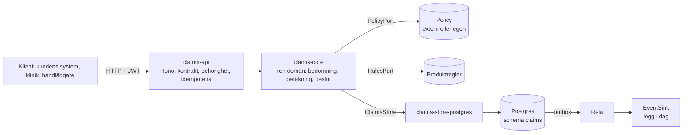

# Arkitektur

Hur Petvold är byggt och varför. Besluten bakom finns i [ADR](../adr/README.md).

## Översikt

Petvold är en modulär monolit (ADR 0001): en process och en databas per installation, men moduler med hårda gränser. En modul läser aldrig en annan moduls tabeller. Den använder modulens API, ett gränssnitt (port) eller händelser.

## Moduler i dag

| Modul | Ansvar | Beror på |
| --- | --- | --- |
| `common` | Värdetyper: `Money`, `MinorUnits`, `BasisPoints`, `ISODate`, `DateRange`, marknad och valuta (ADR 0011) | inget |
| `claims-core` | Domänen: regler, beräkning, tjänsten `ClaimsService`, portar, ledgerns kontonamn, reläet | `common` |
| `claims-store-memory` | Lagring i minnet och exempeldata, för tester och snabb utveckling | `claims-core` |
| `claims-store-postgres` | Lagring i Postgres med ren SQL (ADR 0015) och idempotensnycklar | `claims-core`, `pg` |
| `claims-api` | HTTP-lagret: validering mot kontraktet, autentisering, idempotens, felöversättning, språk | `claims-core`, Hono |

## Portar och adaptrar

Kärnan (`*-core`) är ren: ingen I/O, inget ramverk och inga texter för användare. Allt den behöver från omvärlden får den via gränssnitt i `claims-core/src/ports.ts`:

| Port | Ger kärnan | Implementationer |
| --- | --- | --- |
| `PolicyPort` | Policyn som den gällde ett datum, enligt det som var känt vid en tidpunkt | Minne (exempeldata). Senare policymodulen eller ett externt system. |
| `RulesPort` | Produktens skaderegler per version | Minne (exempeldata). Senare produktkatalogen. |
| `ClaimsStore` | Ärenden, beslut, självriskperioder, förbrukat belopp | Minne och Postgres. Båda klarar samma testsvit. |
| `ClaimsOutbox` | Händelser som väntar på att publiceras | Minne och Postgres |
| `EventSink` | Var reläet publicerar | Logg i dev-servern |
| `Clock`, `IdGenerator` | Tid och id:n | Fasta i tester, riktiga i drift |

En ny lagring är klar när den klarar den gemensamma sviten i `claims-core/test-suites/claims-store.ts` (ADR 0012).

## Lagring

- **Ett schema per modul** (`claims`), och varje modul ansluter med sin egen roll (`claims_service`). Rollen får läsa och lägga till, men inte ändra historik.
- **Databasen upprätthåller reglerna själv:**
  - varje journal balanserar (uppskjuten trigger)
  - självriskperioder för samma djur och grupp överlappar inte (exclusion constraint)
  - beslut och bokföring kan inte ändras eller raderas
- **Migreringar** med dbmate i `db/migrations/`. En körd migration ändras aldrig. CI provar att den senaste kan rullas tillbaka med data i tabellerna.
- **Belopp** är `bigint` i minsta enhet med suffixet `_minor`, och valutan står en gång per rad (ADR 0014).

## Beviskedja

Varje beslut sparas med sitt underlag i `claims.decision_evidence` (ADR 0018), i samma transaktion som beslutet:

| Fält | Innehåll |
| --- | --- |
| `input` | `AssessmentInput`: ärendet, policyutdraget, reglerna, öppen självriskperiod och förbrukat belopp. `sha256(canonicalJson(input))` är beslutets `inputHash`. |
| `calculation_model` | `CALCULATION_MODEL` i `assess.ts`, i dag `vet-care.v1` |
| `engine_version` | `engineVersion` i `ClaimsServiceDeps`. Dev-servern tar `PETVOLD_VERSION` eller git-commit. |

- **Databasen kräver underlaget.** En uppskjuten trigger avvisar ett beslut utan underlag vid commit, och tjänsterollen kan inte ändra eller radera underlaget.
- **Avvikelser är spärrade i databasen.** En check-constraint kräver skälkod och motivering när `deviates_from_proposal` är satt.
- **Testerna bevisar omräkningen.** `assess(evidence.input)` ger exakt den sparade bedömningen, både i minnet och efter en tur genom Postgres `jsonb`.

**Omräkning:** `replay()` i `claims-core/src/replay.ts` väljer beräkningsmodell ur `CALCULATION_MODELS`, kör det sparade underlaget och jämför med den sparade bedömningen fält för fält (JSON-pekare). Den används både av API:et (`POST /v1/claims/{id}/decisions/{seq}/replays`) och av scenariotesterna i CI ([Testning](testning.md#scenarier)). En ändring i `assess` eller `calculate` som ändrar resultatet för sparade beslut ska bli en ny beräkningsmodell, och den gamla behålls.

**Förklaring:** `explainDecision()` i `claims-core/src/explain.ts` är en ren funktion av beslutet, underlaget och ärendets begäranden om prövning. Den ger nycklar och värden, ingen text. API:et lägger till text med `localizeExplanation()` i `messages.ts`.

**Mänsklig prövning:**
- **Tabeller.** `claims.decision.automated` märker automatiska beslut. Begäranden ligger i `claims.review_request` (migration 0006). Beslutet som besvarar en begäran har `review_request_id`.
- **Stängning.** Den stängs i samma transaktion som beslutet (`DecisionCommit.closesReviewRequestId`).
- **Databasen upprätthåller reglerna:**
  - högst en öppen begäran per ärende (unikt partiellt index)
  - begäran gäller ett automatiskt beslut i samma ärende
  - den stängs en gång, av det mänskliga beslut som besvarar den (trigger)
  - ett automatiskt beslut kan inte vara en prövning (check-constraint)
- **Behörighet.** Tjänsterollen får bara uppdatera kolumnerna som stänger begäran.

**Attestkedja (ADR 0019):**
- **Tabeller.** Beslutsförslag ligger i `claims.decision_proposal` (migration 0008). Ett beslut som kommer från en attest har `approved_by` och `proposal_id`.
- **Samma transaktion.** Attesten sparar beslutet, underlaget, bokföringen, utbetalningsordern och stängningen av förslaget i en transaktion (`DecisionCommit.closesProposalId`).
- **Databasen upprätthåller reglerna:**
  - högst ett öppet förslag per ärende (unikt partiellt index)
  - förslaget överstiger alltid förslagsställarens gräns
  - attestanten är aldrig den som beslutade (check-constraints på både förslag och beslut)
  - förslaget stängs en gång, och bara stängningsfälten får ändras (trigger och kolumnrättigheter)
- **Gränser.** De räknas ut i API-lagret (`amountLimitsOf` i `permissions.ts`) och skickas till tjänsten som `decisionLimits` och `approvalLimits`. Fyraögonsprincipen och gränskontrollen ligger i `claims-core`, så att de kan testas utan HTTP (ADR 0016).

## Ledgern

Varje beslut som ändrar ersättningen bokförs som en journal med fyra rader som summerar till noll:

| Konto | Belopp |
| --- | ---: |
| `limit_consumed:SEK:ani_bella:vet_care:2026-04-01` | + 150 000 |
| `limit_available:SEK:ani_bella:vet_care:2026-04-01` | − 150 000 |
| `claim_expense:SEK:clm_021877` | + 150 000 |
| `claim_payable:SEK:clm_021877` | − 150 000 |

Kontonamnen byggs bara i `claims-core/src/ledger.ts`. Förbrukat försäkringsbelopp är saldot på `limit_consumed` för nyckeln. En omprövning bokför bara skillnaden.

## Händelser

Händelser skrivs till `claims.outbox` i samma transaktion som ändringen (ADR 0008). Ett relä läser outboxen i ordning, publicerar och markerar händelserna som publicerade. Leveransen sker minst en gång, så mottagare måste tåla dubbletter. Bara ett relä per outbox åt gången.

## API

- **Kontraktet först** (ADR 0002). `modules/claims-api/openapi.yaml` är källan. Anrop valideras mot schemat, och `lint:openapi` kontrollerar att kontrakt och kod har exakt samma operationer.
- **Fel** som `application/problem+json` (RFC 9457).
- **Idempotens:** anrop som skapar något kräver `Idempotency-Key`. Svaret sparas per anropare och nyckel, i Postgres när dev-servern kör mot databasen.
- **Språk:** regelskäl är koder som översätts efter `Accept-Language` (`messages.ts`).
- **Behörighet (ADR 0016):** varje operation har en rättighet i kontraktet (`x-permission`). En middleware hittar operationen som matchats, läser rättigheten ur kontraktet och jämför med anroparens roller (`permissions.ts`). Rättigheterna står inte i koden. `createApp` vägrar starta om en operation saknar giltig rättighet eller om rollinställningen har en okänd rättighet, och `lint:openapi` stoppar samma fel i CI. Se [Behörighet](../funktion/behorighet.md).
- **Omfång (ADR 0016 del 2):**
  - **Var omfånget räknas ut.** Samma middleware räknar ut anroparens omfång (`scopeOf` i `permissions.ts`) ur tokenens `markets`, `clinicId` och `policyIds` och rollernas `bindsTo`.
  - **Ärenden.** En andra middleware på `/v1/claims/:claimId/*` läser ärendet och svarar 404 om det ligger utanför omfånget (`coversClaim`). Alla anrop på ett ärende går därför genom samma kontroll, även nya.
  - **Anmälan, förhandsbesked och försäkringsbelopp** kontrolleras i sina handlers.
  - **Klinik-id.** Klinikens id sparas på ärendet från tokenen (`claims.claim.clinic_id`, migration 0007).
  - **Kontrollen ligger i koden, inte i databasen** (ingen radsäkerhet, se ADR 0016). Testerna provar varje fall per roll.

## Installation

En installation per försäkringsbolag (ADR 0010), på Kubernetes med CloudNativePG (ADR 0004). Lokalt kör Postgres i docker compose med samma version (ADR 0013).
