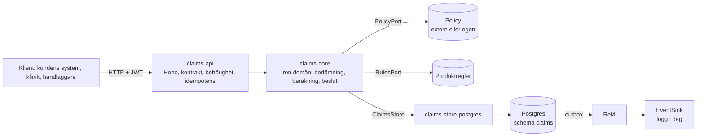

# Arkitektur

Hur Petvold är byggt och varför. Besluten bakom finns i [ADR](../adr/README.md).

## Översikt

Petvold är en modulär monolit (ADR 0001): en process och en databas per installation, men moduler med hårda gränser. En modul läser aldrig en annan moduls tabeller. Den använder modulens API, ett gränssnitt (port) eller händelser.

## Moduler i dag

| Modul | Ansvar | Beror på |
| --- | --- | --- |
| `common` | Värdetyper: `Money`, `MinorUnits`, `BasisPoints`, `ISODate`, `DateRange`, marknad och valuta (ADR 0011) | inget |
| `claims-core` | Domänen: regler, beräkning, tjänsten `ClaimsService`, portar, ledgerns kontonamn, reläet | `common` |
| `claims-store-memory` | Lagring i minnet och exempeldata, för tester och snabb utveckling | `claims-core` |
| `claims-store-postgres` | Lagring i Postgres med ren SQL (ADR 0015) och idempotensnycklar | `claims-core`, `pg` |
| `claims-api` | HTTP-lagret: validering mot kontraktet, autentisering, idempotens, felöversättning, språk | `claims-core`, Hono |

## Portar och adaptrar

Kärnan (`*-core`) är ren: ingen I/O, inget ramverk och inga texter för användare. Allt den behöver från omvärlden får den via gränssnitt i `claims-core/src/ports.ts`:

| Port | Ger kärnan | Implementationer |
| --- | --- | --- |
| `PolicyPort` | Policyn som den gällde ett datum, enligt det som var känt vid en tidpunkt | Minne (exempeldata). Senare policymodulen eller ett externt system. |
| `RulesPort` | Produktens skaderegler per version | Minne (exempeldata). Senare produktkatalogen. |
| `ClaimsStore` | Ärenden, beslut, självriskperioder, förbrukat belopp | Minne och Postgres. Båda klarar samma testsvit. |
| `ClaimsOutbox` | Händelser som väntar på att publiceras | Minne och Postgres |
| `EventSink` | Var reläet publicerar | Logg i dev-servern |
| `Clock`, `IdGenerator` | Tid och id:n | Fasta i tester, riktiga i drift |

En ny lagring är klar när den klarar den gemensamma sviten i `claims-core/test-suites/claims-store.ts` (ADR 0012).

## Lagring

- **Ett schema per modul** (`claims`), och varje modul ansluter med sin egen roll (`claims_service`). Rollen får läsa och lägga till, men inte ändra historik.
- **Databasen upprätthåller reglerna själv:**
  - varje journal balanserar (uppskjuten trigger)
  - självriskperioder för samma djur och grupp överlappar inte (exclusion constraint)
  - beslut och bokföring kan inte ändras eller raderas
- **Migreringar** med dbmate i `db/migrations/`. En körd migration ändras aldrig. CI provar att den senaste kan rullas tillbaka med data i tabellerna.
- **Belopp** är `bigint` i minsta enhet med suffixet `_minor`, och valutan står en gång per rad (ADR 0014).

## Ledgern

Varje beslut som ändrar ersättningen bokförs som en journal med fyra rader som summerar till noll:

| Konto | Belopp |
| --- | ---: |
| `limit_consumed:SEK:ani_bella:vet_care:2026-04-01` | + 150 000 |
| `limit_available:SEK:ani_bella:vet_care:2026-04-01` | − 150 000 |
| `claim_expense:SEK:clm_021877` | + 150 000 |
| `claim_payable:SEK:clm_021877` | − 150 000 |

Kontonamnen byggs bara i `claims-core/src/ledger.ts`. Förbrukat försäkringsbelopp är saldot på `limit_consumed` för nyckeln. En omprövning bokför bara skillnaden.

## Händelser

Händelser skrivs till `claims.outbox` i samma transaktion som ändringen (ADR 0008). Ett relä läser outboxen i ordning, publicerar och markerar händelserna som publicerade. Leveransen sker minst en gång, så mottagare måste tåla dubbletter. Bara ett relä per outbox åt gången.

## API

- **Kontraktet först** (ADR 0002). `modules/claims-api/openapi.yaml` är källan. Anrop valideras mot schemat, och `lint:openapi` kontrollerar att kontrakt och kod har exakt samma operationer.
- **Fel** som `application/problem+json` (RFC 9457).
- **Idempotens:** anrop som skapar något kräver `Idempotency-Key`. Svaret sparas per anropare och nyckel, i Postgres när dev-servern kör mot databasen.
- **Språk:** regelskäl är koder som översätts efter `Accept-Language` (`messages.ts`).
- **Behörighet:** roller per anrop i dag. Rättigheter i kontraktet och omfång per marknad och klinik är föreslaget i ADR 0016.

## Installation

En installation per försäkringsbolag (ADR 0010), på Kubernetes med CloudNativePG (ADR 0004). Lokalt kör Postgres i docker compose med samma version (ADR 0013).
