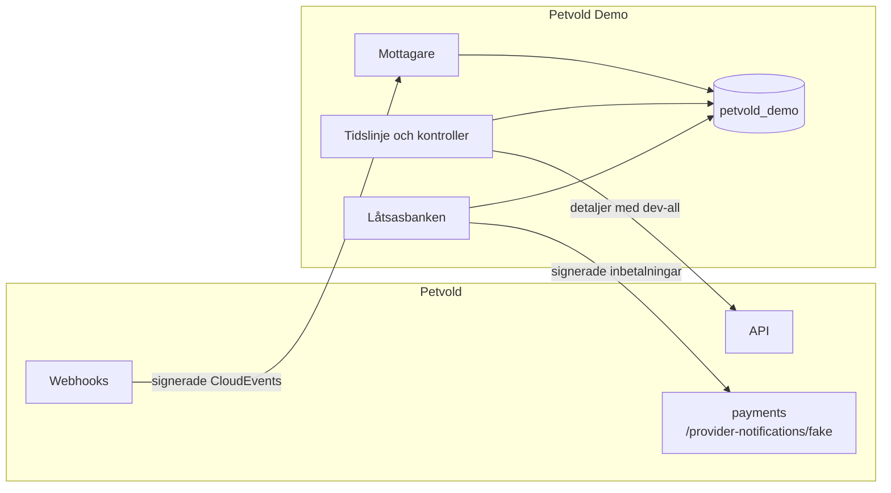

# Demotjänsten

Specen för Petvold Demo: en fristående tjänst som spelar försäkringsbolagets andra system. Den tar emot Petvolds händelser, spelar bank och kund, och kontrollerar hela tiden att händelserna och pengarna stämmer. Den använder bara Petvolds publika kontrakt och körs aldrig i drift.

**Läge 2026-11-23:** inget av tjänsten är byggt. Petvold har det fas 1 och 2 behöver, och för fas 3 finns steg 3 i ADR 0040: låtsasbanken, inbetalningar, koppling till fakturor och utbetalningar. Specen skrevs först som ett eget dokument (2026-11-21) och flyttades hit, där den hålls aktuell med koden. Demon den ska köras i beskrivs i [Demon](demo.md) och ADR 0041.

## Syfte och avgränsning

Tjänsten ska visa, för hand eller i en demo, att varje steg i kundresan ger rätt händelser och rätt pengar. Den ersätter inte testerna i Petvold. Den visar samma sak utifrån, som ett försäkringsbolags system skulle se den.

**Den ska:**
- ta emot alla publika händelser från Petvold som webhooks och kontrollera signaturen
- visa händelserna som en tidslinje per policy, skada, kund och betalarkonto
- köra kontroller som visar om något saknas, kommer dubbelt eller inte stämmer i belopp
- spela bank och kund: betala, betala för lite, betala utan referens och ta emot utbetalningar
- fungera som exempel på hur ett bolag integrerar mot Petvold

**Den får aldrig:**
- läsa Petvolds databas eller importera kod från Petvolds moduler, bara anropa API:t och ta emot webhooks
- köras i drift eller nå en riktig bank eller betaltjänst
- spara personuppgifter utöver det som syns i Petvolds API för den token den använder

Tjänsten ligger i repot som `apps/demo`, men byggs och körs som en egen process med en egen port. Den har ingen gemensam kod med kärnan utöver de genererade typerna från kontrakten.

## Översikt



Petvold skickar händelser till demons mottagare, och demon hämtar detaljer och sköter prenumerationen via API:t. Låtsasbanken skickar inbetalningar till `payments`. Utbetalningarna betalar låtsasbanken ut direkt, och banken ser dem i `payout.paid`. Demon läser aldrig Petvolds databas och har en egen.

## Koppling till Petvold

Tjänsten pratar med Petvold på tre sätt, alla genom kontraktet:
- webhooks in
- API-anrop ut för detaljer
- låtsasbankens inbetalningar tillbaka

### 1. Prenumerationen

- Med token `dev-integration` hämtar tjänsten `GET /v1/webhook-subscriptions` och letar efter en prenumeration på sin egen adress (`DEMO_PUBLIC_URL` och `/webhooks/petvold`).
- **Saknas den** skapas den med `POST /v1/webhook-subscriptions`: typerna `*` och marknaderna `*`. Hemligheten (`whsec_…`) finns bara i svaret och sparas i tjänstens egen lagring.
- **Finns den men tjänsten saknar hemligheten,** byts hemligheten med `POST /v1/webhook-subscriptions/{id}/secret-rotations`. Det är det vanliga i demon, se nedan.
- **Dev-servern** tillåter `http://localhost`. Demon på servern tillåter `http://demo` på det interna nätet (`PETVOLD_WEBHOOK_ALLOW_HOSTS=demo`).

**Historiken i demon.** `npm run demo:seed` skapar händelserna för sex månader innan Petvold startar ([Demon](demo.md#testdata)). Med `DEMO_WEBHOOK_URL` prenumererar testdatan själv på demotjänstens adress innan något händer. Varje händelse väntar då på demotjänsten. När Petvold startar skickas allt, signerat med den tid det skickas, så tidskontrollen godtar det. Händelsernas `time` är fortfarande dagen de hände. Demotjänsten byter hemligheten när den startar och får då hela historiken. Ingen hemlighet behöver stå i någon logg.

### 2. Ta emot en händelse

- **Signaturen** kontrolleras enligt Standard Webhooks: HMAC-SHA256 av `webhook-id.webhook-timestamp.innehåll` med hemligheten, jämförd i konstant tid. Rubriken kan ha två signaturer när hemligheten byts, och en som stämmer räcker.
- **En tidsstämpel** som ligger mer än fem minuter fel avvisas.
- **Händelsen sparas rå** (CloudEvent med `id`, `type`, `subject`, `time`, `market`, `sequence` och `data`), och tjänsten svarar `204` direkt. All tolkning sker efteråt, så att Petvolds omförsök inte styrs av tjänstens fel.
- **En dubblett** känns igen på `webhook-id` och sparas som ett försök till, inte som en ny händelse, så att den syns i kontrollerna.
- **En händelse med fel signatur** sparas i en egen lista med skälet och besvaras med `401`. Den räknas aldrig in i kontrollerna.

### 3. Hämta detaljer

Händelserna är tunna (ADR 0033): id:n, belopp, datum och koder, men inga namn och inga kontonummer. Tidslinjen hämtar resten när den visas, till exempel `GET /v1/policies/{id}`, `GET /v1/claims/{id}`, `GET /v1/invoices/{id}` och `GET /v1/payouts/{id}`. Svaren sparas inte, så att tjänsten inte samlar personuppgifter.

| Token | Används till |
| --- | --- |
| `dev-integration` | Prenumerationen och listan över leveranser |
| `dev-all` | Läsa policyer, skador, parter, meddelanden, fakturor, inbetalningar och utbetalningar. `dev-all` har rollen `billing-clerk`. |
| `dev-customer` | Kundens handlingar, om ett scenario behöver det |

## Händelserna

Händelserna som finns 2026-11-23, med källa. Kontrakten är `modules/api/asyncapi.yaml` och [Webhooks](../funktion/webhooks.md).

| Källa | Händelser |
| --- | --- |
| `/petvold/policies` | `policy.issued`, `.changed`, `.renewed`, `.transferred`, `.cancelled`, `.reinstated`, `application.*`, `proposal.created` |
| `/petvold/claims` | `claim.registered`, `.decision_proposed`, `.proposal_returned`, `.decided`, `.payout_ordered`, `.review_requested`, `.withdrawn`, `.dismissed`, `.corrected`, `.attachment_added`, `.information_*` |
| `/petvold/animals` | `animal.ownership_changed`, `animal.died` |
| `/petvold/communications` | `notice.created`, `.document_made`, `.delivered`, `.failed` |
| `/petvold/billing` | `invoice.issued`, `invoice.credited`, `invoice.paid` |
| `/petvold/payments` | `payment.succeeded`, `payout.paid`, `payout.failed` |
| `/petvold/scheduling` | `job.failed` |

## Tidslinjen

Startsidan svarar på en fråga: stämmer allt just nu? Därunder kan man gå från en kund till varje händelse och varje krona.

| Vy | Visar | Uppdateras |
| --- | --- | --- |
| **Översikt** | Antal händelser per typ senaste timmen, kontroller som inte stämmer, händelser med fel signatur och dubbletter. Ett stort "Allt stämmer" eller en lista över det som inte gör det. | Live, med server-sent events |
| **Händelser** | Alla händelser, nyast först, med filter på typ, marknad, `subject` och tid. En rad visar tid, typ, subject och de viktigaste fälten ur `data` (belopp, datum, skäl). Klick visar hela CloudEvent och rubrikerna. | Live |
| **Policy** | Policyns händelser i ordning, med premien per term, ändringar, avslut och premie tillbaka. Bredvid premieplanen, fakturorna med status och inbetalningarna. | Vid visning |
| **Skada** | Från anmälan till utbetalning: registrerad, förslag, attest, beslut, utbetalningsorder och utbetald till kunden eller kliniken. Varje steg med tid och belopp. | Vid visning |
| **Kund** | Kundens policyer, skador och meddelanden, och betalarkontot med det som är obetalt och tillgodohavandet. | Vid visning |
| **Kontroller** | Varje kontroll med status, senaste körning och de objekt som inte stämmer, med länk till objektet. | Efter varje händelse och var femte minut |
| **Banken** (fas 3) | Kundernas, klinikernas och bolagets konton i låtsasbanken, fakturor att betala, utbetalningar och knapparna för att spela kund. | Live |

- **Ordning:** händelser från samma källa sorteras på `sequence`, och mellan källor på `time` och sedan på mottagningsordning. Petvold lovar ingen ordning (ADR 0033), så en händelse som kommer före sin orsak visas med en markering i stället för att gömmas.
- **Länkar:** varje id länkar till demons vy och till samma objekt i Petvolds back office, så att man kan jämföra.
- **Utseende:** Petvolds designsystem ([Designsystem](designsystem.md)): svartvitt, ramar i stället för skuggor, och tillstånd med helfylld eller streckad linje. En kontroll som inte stämmer markeras med streckad ram och en text, aldrig bara med färg.
- **Språk:** gränssnittet är på svenska och koden på engelska, som i Petvold.

## Kontrollerna

En kontroll är en regel över de mottagna händelserna, och i fas 3 låtsasbanken. Den stämmer, eller pekar ut objekten som inte gör det. Kontrollerna är rena funktioner över händelselistan, så att de går att testa med inspelade händelser.

**Utfall per objekt:**
- stämmer
- väntar: nästa händelse har inte kommit, men tidsgränsen har inte gått ut
- stämmer inte, med skälet i klartext

Tidsgränsen är en inställning med förvalet 2 minuter, så att en långsam reläkörning inte ger falsklarm.

**Fas 2, mot det som finns i Petvold:**

| Id | Kontroll | Bygger på |
| --- | --- | --- |
| H1 | Varje händelse har giltig signatur och tidsstämpel. | Alla |
| H2 | En händelse som levererats flera gånger (samma `webhook-id`) räknas en gång. Antalet dubbletter syns, eftersom de inte är fel men ska märkas. | Alla |
| H3 | Varje belopp är ett heltal med en valuta på tre bokstäver, och alla belopp för samma policy eller skada har samma valuta. | Alla med belopp |
| P1 | `application.accepted` följs av `policy.issued` med samma `applicationId`. | Ansökningar, policyer |
| P2 | Termerna följer varandra: `policy.renewed` har `termNo` ett högre än förra termen och `startDate` lika med förra termens `endDate`. | `policy.issued`, `policy.renewed` |
| P3 | `policy.cancelled`: `effectiveDate` ligger inom en term som händelserna känner till, och `refund` är högst premien för de termer som berörs. | `policy.cancelled` |
| P4 | `policy.reinstated` pekar (`reverses`) på ett avslut som har kommit, och ett avslut återkallas högst en gång. | `policy.cancelled`, `policy.reinstated` |
| P5 | `policy.transferred`: `fromPartyId` är policyns försäkringstagare enligt tidigare händelser. | `policy.issued`, `policy.transferred` |
| S1 | Varje händelse om en skada kommer efter `claim.registered` för samma skada (efter `time`). | Skador |
| S2 | Ett beslutsförslag (`claim.decision_proposed`) följs av `claim.decided` eller `claim.proposal_returned`. | Skador |
| S3 | **Utbetalningsordrarna summerar rätt:** för varje beslut som höjer ersättningen finns exakt en `claim.payout_ordered` med ökningen. Summan av en skadas ordrar är summan av alla höjningar mellan besluten i ordning (`seq`). Sänkningar ger inga återkrav (ADR 0019), så summan kan bli större än den sista ersättningen. | `claim.decided`, `claim.payout_ordered` |
| M1 | `notice.created` följs av `notice.delivered` eller `notice.failed`. Med `documentMaker: petvold` kommer `notice.document_made` före leveransen. | Meddelanden |

**Fas 3, med stegen i ADR 0040:**

| Id | Kontroll | Finns från |
| --- | --- | --- |
| B1 | Varje `policy.issued` och `policy.renewed` ger en premieplan vars delbetalningar summerar exakt till termens premie (`GET /v1/premium-plans?policyId=…`). | Steg 2, finns |
| B2 | Varje faktura summerar till sina rader, och varje rad hör till en plan. En faktura med `invoice.credited` har `credited` lika med kreditnotornas summa. | Steg 2, finns |
| B3 | Varje inbetalning som låtsasbanken skickat ger `payment.succeeded` och syns i `GET /v1/received-payments`, antingen kopplad till ett konto eller bland de okopplade (`status=unmatched`). Ingen försvinner. En inbetalning med en fakturas OCR och hela beloppet ger `invoice.paid`. | Steg 3, finns |
| B4 | **Varje utbetalningsorder betalas ut exakt en gång** med samma belopp: `claim.payout_ordered` följs av `payout.paid` med samma `orderId`, och mottagarens konto i låtsasbanken ökar med beloppet. En order med `clinicId` går till kliniken bara om den har ett avtal om direktreglering (`GET /v1/clinic-agreements`). En utbetalning som väntar på uppgifter eller är spärrad räknas som "väntar". | Steg 3, finns |
| B5 | En obetald faktura ger `invoice.overdue` (påminnelse) och sedan `policy.cancelled` med skälet `unpaid-premium` för varje policy på fakturan, i den ordningen och med marknadens dagar (7 och 21 dagar efter förfallodagen). En betalning före uppsägningsdagen ger `policy.reinstated`. | Steg 4, finns |
| B6 | Efter ett avslut: det kunden betalat minus termens premie efter `refund` blir ett tillgodohavande. Det används på nästa faktura (`invoice.paid` med `paidWith: credit`) eller betalas tillbaka (`refund.ordered` och `payout.paid` med `purpose: premium-refund`), och bankens saldo för kunden stämmer med det. | Steg 5a, finns |
| B7 | Dagsavslutet balanserar: debet är lika med kredit per dag och valuta, och varje händelse med pengar finns i en verifikation (`GET /v1/verifications?objectId=…`). | Steg 6a finns, dagsavslutet i 6b |
| B8 | **Banken och Petvold är överens:** för varje kund och klinik är summan av in- och utbetalningar i låtsasbanken lika med det Petvold har registrerat (`GET /v1/payments`, `GET /v1/payouts`). | Steg 3, finns |

Nya kontroller läggs till som en funktion och en rad i tabellen. Varje kontroll har ett test med inspelade händelser där den stämmer och ett där den inte gör det.

## Låtsasbanken

Låtsasbanken spelar både banken och kunden, så att pengarna i Petvold kan jämföras med pengar som faktiskt "flyttats".

**Konton.** Banken har ett konto per kund (efter `partyId`), ett per klinik (efter `clinicId`) och ett för försäkringsbolaget. Varje kundkonto börjar med ett saldo som är en inställning (förval 10 000 kr). Belopp är heltal i minsta enhet med valuta, som i Petvold. Varje rörelse sparas med tid, belopp, motpart och referens, och ändras aldrig.

**Inbetalningar till Petvold** skickas som `fake`-adapterns aviseringar till `POST /provider-notifications/fake`, signerade med `PETVOLD_FAKE_BANK_SECRET` på samma sätt som Petvolds webhooks. Formatet står i [Premier och betalningar](../funktion/premier.md#låtsasbanken-fake):

```json
{
  "schema": "petvold-fake-bank.v1",
  "payments": [
    { "id": "fb_1", "market": "SE", "currency": "SEK", "amount": 41200,
      "reference": "202600000121", "bookedOn": "2026-12-01" }
  ]
}
```

- `id` är bankens eget id för betalningen. Samma id två gånger är samma betalning.
- Svaret är `200` med antal nya och redan mottagna, `401` vid fel signatur och `400` vid fel innehåll.

**Utbetalningar från Petvold** betalar `fake`-adaptern direkt. Banken ser dem i `payout.paid` (`partyId` eller `clinicId`, `amount` och `orderId`) och sätter in beloppet på mottagarens konto. Kontonumret finns aldrig i händelsen, och banken behöver det inte.

**Vad man kan göra som kund:**

| Handling | Vad som skickas till Petvold | Vad Petvold gör | Kontroll |
| --- | --- | --- | --- |
| Betala en faktura | En inbetalning med fakturans OCR och belopp | Kopplar den och skickar `invoice.paid` | B3, B8 |
| Betala för lite | En inbetalning med OCR och ett lägre belopp | Fakturan blir `partly-paid` | B3 |
| Betala för mycket | En inbetalning med OCR och ett högre belopp | Fakturan betalas, resten går till äldsta förfallna och sedan till tillgodohavande | B3, B6 |
| Betala utan referens eller med fel referens | En inbetalning utan OCR, eller med en okänd | Den hamnar bland de okopplade tills en handläggare kopplar den | B3 |
| Betala samma faktura två gånger | Två inbetalningar med samma OCR | Den andra går till kontots äldsta förfallna faktura, och det som blir över blir tillgodohavande | B3, B6 |
| Ge eller byta betaluppgifter | `POST /v1/payees/{partyId}/accounts` med `dev-all` | Väntande utbetalningar skickas, eller spärras om uppgifterna är nya | B4 |
| Låta en dragning studsa | En dragning som först lyckas och sedan återförs | Finns inte än: kommer med Autogiro (steg 7) | B5 |

**Automatiskt läge.** En inställning låter banken betala varje faktura på förfallodagen, så att en lång demo kan köras utan klick. Ett andelsfält (förval 0 %) låter en del av betalningarna utebli.

**Bankfiler (steg 7):** banken läser Petvolds `pain.001` och betalar ut, och skriver `camt.054` med dagens inbetalningar som Petvold läser in. Banken validerar filerna mot ISO 20022-schemat och visar fel i klartext. Stripe, Surfboard, Autogiro och Swish testas mot respektive tjänsts egen testmiljö, inte mot låtsasbanken.

**Körningar.** Fakturering, påminnelser och uppsägningar är körningar i Petvold (ADR 0037). Bankens vy har knappar som startar dem med `POST /v1/jobs/{job}/runs`, så att man inte behöver vänta på schemat.

## Data och teknik

Samma stack som Petvold, så att den är lätt att läsa för den som känner kärnan, men utan gemensam kod.

| Del | Val |
| --- | --- |
| Språk och server | TypeScript på Node 24 med Hono, en process som både tar emot webhooks och serverar gränssnittet |
| Gränssnitt | Lit och Web Awesome med Petvolds tokens från `design/tokens.json`, uppdateringar med server-sent events |
| Lagring | En egen databas `petvold_demo` i samma Postgres som Petvold, med en egen roll `demo_service`, node-postgres och migreringar med dbmate i `apps/demo/db/`. Aldrig Petvolds databas. |
| Typer | Genererade från `modules/api/openapi.yaml` och `modules/api/asyncapi.yaml`, så att en ändring i kontraktet syns som typfel |
| Tester | Kontrollerna som rena funktioner med inspelade händelser, signaturen mot Standard Webhooks testvektorer, och ett flöde med Playwright |

**Tabeller:**

| Tabell | Innehåll |
| --- | --- |
| `event` | En rad per händelse (CloudEvent `id`): typ, subject, marknad, `time`, `sequence`, `data` som JSON, första mottagning |
| `delivery` | En rad per mottaget anrop: `webhook-id`, tid och om signaturen stämde. Visar dubbletter. |
| `rejected` | Anrop med fel signatur eller för gammal tidsstämpel, med skälet |
| `check_result` | Senaste utfall per kontroll och objekt, med skäl och tid |
| `bank_account`, `bank_movement` | Låtsasbankens konton och rörelser |
| `setting` | Prenumerationens id och hemlighet, och inställningar som ändrats i gränssnittet |

**Inställningar** (miljövariabler, förval för den lokala miljön):

| Variabel | Förval | I demon på servern |
| --- | --- | --- |
| `PETVOLD_API_URL` | `http://localhost:8787` | `http://api:8080` |
| `PETVOLD_BACKOFFICE_URL` | `http://localhost:5180` | `DEMO_PUBLIC_URL` utan `/demo` |
| `DEMO_PORT` | `8790` | `8790` |
| `DEMO_PUBLIC_URL` | `http://localhost:8790` | `http://demo:8790`, adressen Petvold skickar webhooks till |
| `DEMO_BASE_PATH` | `/` | `/demo`, där Caddy visar tjänsten |
| `DEMO_DATABASE_URL` | `petvold_demo` i dev-containern | `petvold_demo` i demons Postgres, med rollen `demo_service` |
| `DEMO_INTEGRATION_TOKEN`, `DEMO_READ_TOKEN` | `dev-integration`, `dev-all` | Samma |
| `DEMO_BANK_SECRET` | Dev-serverns hemlighet för låtsasbanken | `PETVOLD_FAKE_BANK_SECRET` ur `.env` |
| `DEMO_CHECK_TIMEOUT_SECONDS` | `120` | `120` |
| `DEMO_START_BALANCE` | `1000000` (10 000 kr i öre) | Samma |

**Lokalt:** `npm run dev` i `apps/demo` startar tjänsten. Den kräver att Petvolds dev-server kör. En knapp "Börja om" tömmer demons databas och skapar prenumerationen igen, utan att röra Petvold.

**I demon på servern** blir tjänsten `demo` i `deploy/demo/compose.yaml`, på det interna nätet och bakom Caddy på `/demo` med samma kaka som resten. `reset.sh` gör då i den här ordningen:
1. Töm Petvolds och demotjänstens databaser.
2. Kör testdatan med `DEMO_WEBHOOK_URL=http://demo:8790/webhooks/petvold`.
3. Starta allt. Demotjänsten byter hemligheten, och Petvold skickar historiken.

## Det Petvold behöver lägga till

Demon ska bara använda kontraktet. Det här saknas eller behövde bekräftas i Petvold, kontrollerat mot kontrakten 2026-11-23. Punkterna byggs i Petvold, inte i demon.

| # | Vad | Varför | När |
| --- | --- | --- | --- |
| 1 | Tillägget `sequence` i CloudEvent-kuvertet: platsen i modulens outbox, 20 siffror, ökar per källa | Sortera händelser från samma modul. Ett glapp betyder inte att något saknas. | Klart (PR #128) |
| 2 | `source` i kuvertet täcker alla moduler som skickar händelser | Annars underkänns händelsen av schemat | Klart (PR #128), också `/petvold/billing` och `/petvold/payments` |
| 3 | `payout` i `claim.decided` är skadans totala ersättning efter beslutet | Kontroll S3 | Klart (PR #128) |
| 4 | `termNo` på `policy.issued` och `policy.cancelled`, och försäkringstagaren på `policy.renewed` | Kontroll P2, P3 och B1 utan extra anrop | Öppen |
| 5 | En mottagare för `fake`-adapterns aviseringar, och utbetalningar som banken ser | Låtsasbanken | Klart (PR #138, #146) |
| 6 | Ett sätt att hämta utgående bankfiler och lämna in inkommande | Bankfiler i låtsasbanken | ADR 0040, steg 7 |
| 7 | Testdatan prenumererar på demotjänsten innan något händer (`DEMO_WEBHOOK_URL`) | Demotjänsten får hela historiken | Klart (PR #148) |

Körningar startas redan med `POST /v1/jobs/{job}/runs`, så det behöver inte ändras.

## Leverans i faser

Fas 1 och 2 kan byggas nu. Fas 3 kan börja med B1–B4 och B8, eftersom steg 3 i ADR 0040 är klart.

1. **Fas 1: ta emot.** Prenumerationen vid start, mottagning med signaturkontroll, lagring och listan Händelser.
    - Klart när en policy som tecknas i back office syns i listan inom tio sekunder, med giltig signatur.
    - Klart när ett anrop med fel signatur eller för gammal tidsstämpel får `401` och syns bland avvisade.
    - Klart när en leverans som skickas igen från Petvolds back office syns som dubblett, inte som en ny händelse.
    - Klart när demon på servern visar hela historiken efter `reset.sh`.
2. **Fas 2: visa och kontrollera.** Översikten, vyerna för policy, skada och kund, och kontrollerna H1–M1.
    - Klart när alla fem scenarier i [End-to-end-scenarier](../end-to-end-scenario.md) kan köras i back office och ger "Allt stämmer" i demon.
    - Klart när varje kontroll har ett test där den stämmer och ett där den inte gör det.
3. **Fas 3: pengar.** Låtsasbanken och kontrollerna B1–B8, ett steg i taget när ADR 0040 levererar det.
    - Klart när en hel kundresa med teckning, faktura, betalning i banken, skada, utbetalning till banken och avslut med premie tillbaka ger "Allt stämmer", och kundens saldo i banken stämmer med Petvold.
    - Klart när varje kundhandling i banken ger det utfall som tabellen säger.
4. **Fas 4: exempel för bolag.** En kort guide i `apps/demo/README.md` om hur en integration tar emot händelser från Petvold, med demons kod som exempel.

## Öppna frågor

- **I CI?** Ska scenarierna köras mot demon i CI, med "Allt stämmer" som krav, eller räcker Petvolds egna tester?
- **Flera marknader.** Räcker en prenumeration på alla marknader, eller ska demon kunna visa en marknad i taget? Testdatan har bara Sverige än.

**Besvarade sedan 2026-11-21:**
- **Tid i demon:** testdatan skapar sex månaders historik dag för dag (ADR 0041). Det som ligger framåt, till exempel förnyelser, händer i takt med den riktiga klockan.
- **ADR 0041:** beslutad 2026-11-22. Den beskriver demon som helhet. Gränsen för demotjänsten står här: bara kontraktet, aldrig i drift, egen databas.
