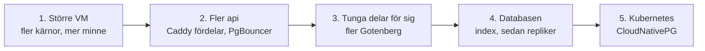
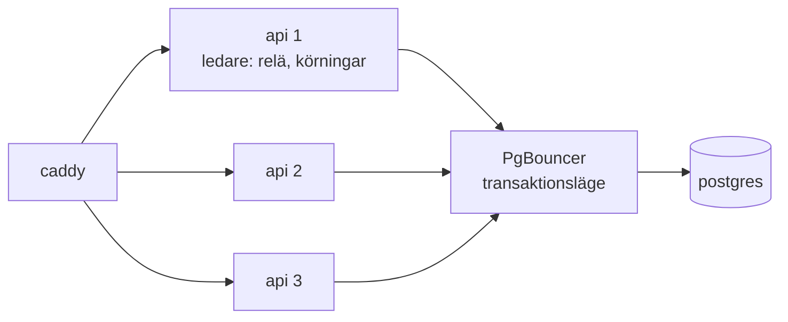

# Skalning

Hur en installation av Petvold skalas för bättre prestanda, steg för steg. Börja med att mäta var det tar stopp, eftersom svaret avgör vilket steg som hjälper. En interaktiv version med räknare för anslutningarna finns som sidan *Skala Petvold* på claude.ai.



## Det som redan klarar flera instanser

- **Inget tillstånd i minnet.** Inloggningen är JWT. Idempotensnycklar, lån och köer ligger i databasen, så vilken instans som helst kan ta nästa anrop.
- **En ledare för bakgrundsarbetet.** Reläet och körningarna tar ett lån i `scheduling.lease` (ADR 0037). En instans leder, och de andra tar över inom 30 sekunder om den försvinner. `/healthz` visar `relay: leading` eller `standby`.
- **Webhook-arbetaren** delar jobben mellan instanserna med `for update skip locked`.

## Steg 1: större VM

Ge servern fler kärnor och mer minne, och låt Postgres använda minnet. Det är det billigaste steget och kräver inga ändringar i Petvold.

```
qm set 102 --cores 6 --memory 8192   # Proxmox, VM 102
```

För Postgres i compose: `shared_buffers` runt en fjärdedel av minnet, och `work_mem` för sorteringar, till exempel `command: ["postgres", "-c", "shared_buffers=2GB", "-c", "work_mem=16MB"]`.

## Steg 2: fler instanser av api



Två saker behövs:

- **Caddy fördelar trafiken** över alla instanser:

  ```
  reverse_proxy {
  	dynamic a api 8080 {
  		refresh 10s
  	}
  	lb_policy least_conn
  	health_uri /health
  }
  ```

- **Databasanslutningarna räcker inte utan PgBouncer.** Varje instans öppnar en pool per modul, 33 anslutningar (tabellen nedan). Postgres tillåter 100 som förval, varav 3 är reserverade, så tre instanser ger 99 av 97. PgBouncer i transaktionsläge håller Postgres på 14 roller × poolen, oavsett antalet instanser. Modulernas `*_DATABASE_URL` pekar då på PgBouncer (port 6432), och `max_client_conn` ska vara minst instanserna × 33.

  ```
  [pgbouncer]
  pool_mode = transaction
  default_pool_size = 5
  max_client_conn = 500
  ```

Petvold fungerar i transaktionsläget: koden använder bara transaktionslås (`pg_advisory_xact_lock`), inga sessionslås, ingen `LISTEN` och inga namngivna prepared statements.

| Modul | Pool |
| --- | ---: |
| `claims` | 5 |
| `parties`, `policies` | 3 var |
| `access`, `decisioning`, `catalog`, `animals`, `communications`, `webhooks`, `billing`, `payments`, `accounting`, `scheduling`, `documents` | 2 var |
| **Per instans** | **33** |

Poolerna finns i `modules/api/src/composition.ts`. Engångsstegen `roles` och `migrate` tar en anslutning var medan de körs.

## Steg 3: tunga delar för sig

PDF:er via Gotenberg kostar mest CPU. Fler instanser av Gotenberg avlastar api direkt: `docker compose up -d --scale gotenberg=3`. Dockers DNS fördelar bara grovt mellan dem. För jämn fördelning läggs Gotenberg bakom Caddy, och `PETVOLD_GOTENBERG_URL` pekar dit.

## Steg 4: databasen

Leta efter dyra frågor och saknade index innan något annat:

```sql
create extension if not exists pg_stat_statements;

select calls, round(mean_exec_time) as ms, left(query, 80)
from pg_stat_statements
order by total_exec_time desc
limit 10;
```

Läsrepliker hjälper först när det är läsningen som tar stopp. De kräver en ändring i koden, eftersom varje modul i dag har en enda adress till databasen.

## Steg 5: Kubernetes

Bortom en maskin blir det Kubernetes med CloudNativePG, som ADR 0004 och 0010 redan pekar ut. Avbildningarna är desamma.

- **api** blir en Deployment med HorizontalPodAutoscaler, och `/healthz` används för readiness.
- **roles och migrate** blir Jobs. Rollerna sköts av `spec.managed.roles` i CloudNativePG.
- **PgBouncer** blir CloudNativePG:s `Pooler`:

  ```yaml
  apiVersion: postgresql.cnpg.io/v1
  kind: Pooler
  metadata:
    name: petvold-rw
  spec:
    cluster:
      name: petvold
    instances: 2
    type: rw
    pgbouncer:
      poolMode: transaction
      parameters:
        default_pool_size: "5"
        max_client_conn: "500"
  ```

## Det som inte skalar ut

- **Reläet** är en enda ledare för alla outboxar, för att hålla ordningen per outbox. Om händelserna börjar släpa efter blir nästa steg ett lån per outbox i stället för ett gemensamt. Det rör ordningsgarantin och kräver en ADR.
- **Körningarna** leds också av en instans i taget. De är korta och körs per marknad.
- **En enda server** är en enda felkälla. Flera instanser på samma maskin ger mer kapacitet, men inte högre tillgänglighet.
